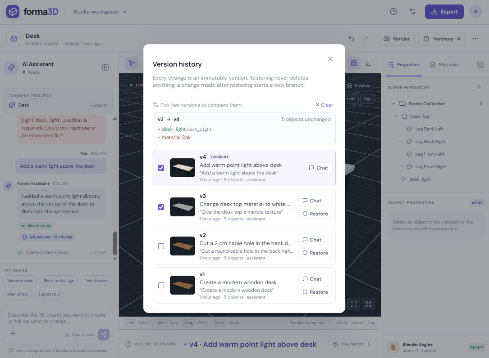
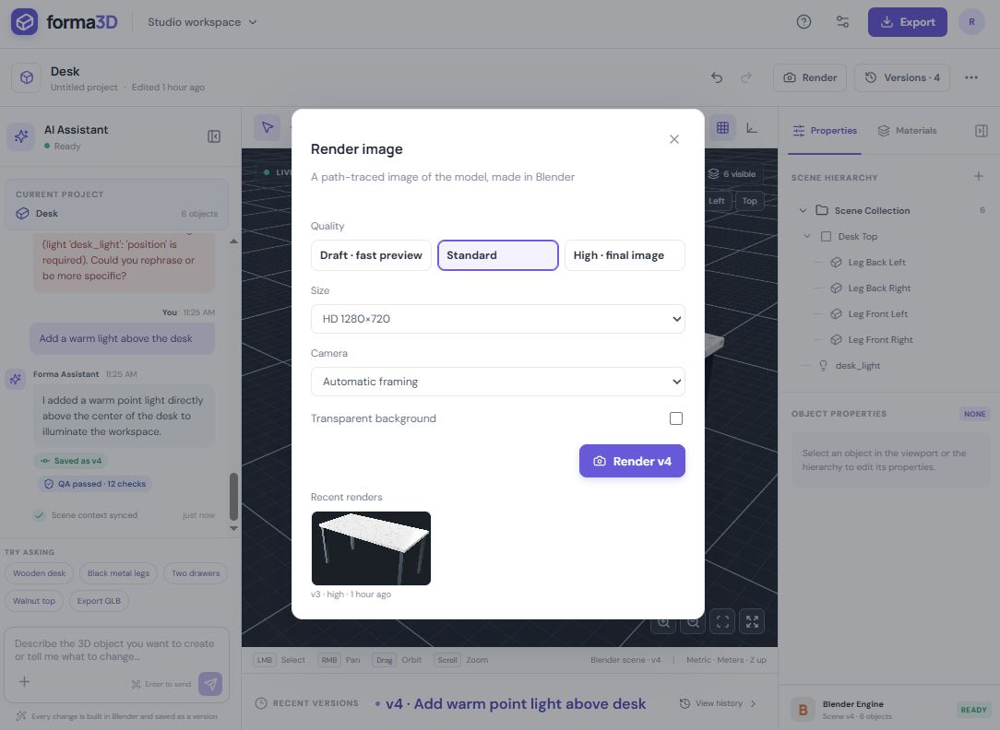
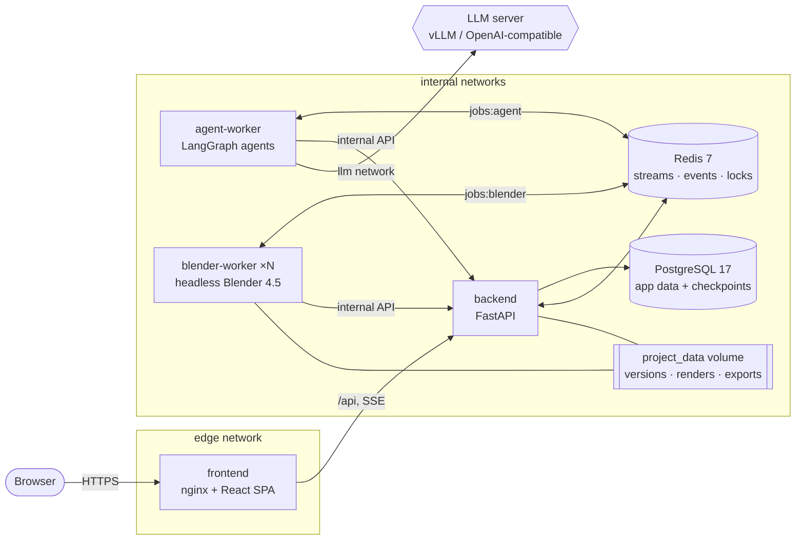

<p align="center">
  <picture>
    <source media="(prefers-color-scheme: dark)" srcset="docs/assets/logo-dark.svg">
    
  </picture>
</p>

<h3 align="center">Conversational AI 3D studio</h3>

<p align="center">
  Describe an object in plain language. AI agents plan it, Blender builds it, and you refine it in the browser:<br>
  by chatting, or by editing it directly. Every change becomes a version you can compare, undo or branch from.
</p>

<p align="center">
  
  
  
  
  
  
  <a href="https://github.com/mkamranr/forma3d/actions/workflows/ci.yml"></a>
  <a href="LICENSE"></a>
</p>

<p align="center">
  <a href="#features">Features</a> ·
  <a href="#screenshots">Screenshots</a> ·
  <a href="#architecture">Architecture</a> ·
  <a href="#deployment-with-docker">Deployment</a> ·
  <a href="#configuration">Configuration</a> ·
  <a href="#operations">Operations</a> ·
  <a href="#development">Development</a> ·
  <a href="#contributing">Contributing</a>
</p>

---

## Why forma3D

- **Talk to it like a designer.** "Create a modern wooden desk", "make the legs black metal", "add two drawers".
  Follow-ups understand the scene and the current selection.
- **Or show it a photo.** Attach a picture of a chair, lamp or cabinet. A vision model reads its parts,
  proportions and materials, and forma3D builds it as an editable 3D model.
- **Real geometry, not a picture.** Every model is a Blender scene you can download as `.blend`, GLB, glTF, OBJ
  or STL, or render with Cycles.
- **Safe by design.** The LLM never writes code. It produces a plan in a validated modeling language (DSL),
  and only allowlisted operations reach a sandboxed, headless Blender.
- **Nothing hidden.** "How this was made" shows the agent graph each request went through: every step, its
  decision, timing and tokens, live while it runs. Administrators can also read the exact LLM prompts.
- **Self-hosted and private.** It runs on your own Docker host with your own LLM (vLLM or any OpenAI-compatible
  server). It also works fully offline or air-gapped.

## Screenshots

<p align="center">
  
  <br><sub><b>Workspace.</b> Chat with the assistant, inspect the live Blender scene, edit objects and step through versions.</sub>
</p>

<p align="center">
  
  <br><sub><b>Dashboard.</b> Your projects with live thumbnails, search, sort and archive.</sub>
</p>

<table>
  <tr>
    <td width="50%" align="center">
      
      <br><sub><b>Version history.</b> Every change is an immutable version: compare any two, jump back to the chat that made it, restore or branch.</sub>
    </td>
    <td width="50%" align="center">
      
      <br><sub><b>Rendering.</b> Path-traced Cycles renders straight from the workspace: quality, size, camera and transparent background.</sub>
    </td>
  </tr>
</table>

## Features

### Conversational modeling
- Natural-language creation and editing, with clarifying questions when a request is ambiguous
  (for example "which drawer?").
- Selection-aware chat, so "make *this* taller" acts on whatever is selected in the viewport or tree.
- A multi-agent workflow (LangGraph):
  1. **Inspection** summarises the current scene.
  2. **Vision** describes attached photos (only when there are any).
  3. **Conversation** works out the intent: build, change, answer, export, render, undo, or ask back.
  4. **Planning** designs the parts, sizes and materials.
  5. **Modeling** compiles the plan into validated DSL operations, which **Blender** builds in isolation.
  6. **Quality** checks geometry, relations and untouched objects.
  7. **Revision** fixes failed checks and rebuilds, a bounded number of times, before the version is saved.
- **Image to 3D**: attach up to 4 photos with **+**, or paste or drop them into the chat.
  - The Vision agent turns them into a structured description: parts, counts, sizes, placement, colours and textures.
  - The planner builds from that description. Add words to steer it ("like this, but in walnut").
  - "What I saw in the photo" under the message shows what was understood.
- Live progress over server-sent events. Every reply shows its version and QA result ("Saved as v4 ·
  QA passed · 12 checks").
- Interrupted workflows resume from PostgreSQL checkpoints after a worker restart.

### See how the agents worked
- Every assistant reply has a **How this was made** button. It opens the LangGraph workflow as a diagram, with
  the path this request took highlighted: numbered steps, revision loops (×2), skipped and failed steps.
  A timeline beside it shows what each agent decided, such as intent, planned parts, validated operations,
  QA checks and issues, with timings, models and token counts.
- While a request runs, **Watch the agents** follows it live, step by step.
- Administrators also see the exact **LLM prompt and raw response** of every call, and get an **Agent activity**
  tab in Configuration listing every user's requests. Prompt storage can be turned off and expires after
  `AGENT_TRACE_PROMPT_RETENTION_DAYS`.

### 3D workspace
- Three.js / React Three Fiber viewport:
  - Orbit, pan and zoom, six camera presets, and perspective/orthographic views.
  - Solid, wireframe and material shading, plus grid and axes.
  - Fit-to-view and fullscreen.
- Click-to-select that stays in sync with the scene hierarchy. Multi-select is supported.
- Transform gizmo (move, rotate, scale) with exact numeric fields.
- Panels for properties, materials, lights and cameras.
- Add primitives, lights and cameras. Rename, hide and delete objects, and re-parent them.

### Modeling engine (51 DSL operations)
- Primitives, curves and custom meshes.
- Extrude and inset; booleans (union, difference, intersect).
- Modifiers: bevel, solidify, subdivide, mirror, array, remesh and decimate.
- Join and separate, origin and transform application, collections and parenting.
- PBR materials with glass (transmission), glow (emission) and procedural textures:
  wood, marble, brick, fabric, concrete, brushed metal and more. You can also upload your own images.
- Every operation is schema-checked and semantically validated (targets, limits, dependencies) before
  Blender runs.

### Versions and history
- Immutable versions with thumbnails, the message that created each one, and an inventory of the scene.
- Undo and redo, restore any version, and branch from the past.
- Compare two versions: objects and materials added, removed or changed, field by field.

### Output
- Export to **GLB, glTF, OBJ or STL**, in metres, centimetres or millimetres, optionally with hidden
  objects. Textures are included.
- **Cycles renders** at draft, standard or high quality, through any scene camera, with an optional
  transparent background. A GPU is used when one is available.
- Renders and exports can be started from chat ("render it", "export as STL").

### Accounts and projects
- Email and password accounts (argon2). Short-lived JWTs with rotating, reuse-detected refresh cookies.
- **Configuration page for administrators** (avatar menu → Configuration): AI model and endpoint (with a
  one-click *Test connection*), rendering and export defaults, modeling limits and retention, and accounts
  (sign-up on/off, activate/deactivate users, grant admin). Changes apply live, without a restart.
- Projects can be created, renamed, duplicated, archived and deleted, with search and sorting.
  Each user's data is isolated.

### Production-ready operations
- Hardened containers:
  - Read-only root filesystems, no capabilities, non-root users.
  - Resource limits and isolated networks.
- Job recovery: crashed workers' jobs are re-run, stuck jobs time out cleanly and stale locks are released.
- Horizontal scaling of Blender and agent workers.
- Prometheus `/metrics`, a readiness endpoint and ready-made alert rules.
- Backup and restore scripts, retention policies, file-based secrets and an optional NVIDIA GPU profile.
- An offline bundle with image digests for air-gapped installs.

## Architecture



**What happens when you send a message**


| Component | Technology | Responsibility |
|---|---|---|
| **frontend** | React 18, TypeScript, Vite, React Three Fiber, TanStack Query, Zustand, nginx | SPA, 3D viewport, chat; nginx serves it and proxies `/api` with security headers |
| **backend** | FastAPI, SQLAlchemy 2 (async), Alembic, Pydantic, structlog | Auth, projects, conversations, the DSL validator, atomic version commits, SSE, maintenance, metrics |
| **agent-worker** | LangGraph, httpx, Postgres checkpointer | The multi-agent modeling workflow and the LLM provider abstraction (vLLM, OpenAI-compatible, offline fake) |
| **blender-worker** | Python 3.12 service + Blender 4.5 LTS (`bl_runtime`, stdlib + bpy only) | Runs validated operation batches, exports, renders and thumbnails in isolated job workspaces |
| **shared** | `forma3d_shared` (Pydantic) | One source of truth for the DSL, plans, jobs, events and inventory contracts |
| **postgres** / **redis** | PostgreSQL 17, Redis 7.4 | Durable state and LangGraph checkpoints / job streams, event replay, project locks, heartbeats |

Key design decisions:
- **Only the backend writes to the database.** Workers use token-authenticated internal endpoints.
- **Versions are immutable** and committed atomically: a directory rename plus one transaction, with
  optimistic concurrency on the head.
- **Stable object IDs** travel from Blender through glTF `extras` to the viewport, so a selection always maps
  to the same object across versions.
- **Every edit takes the same path.** Chat and direct UI edits both compile to DSL and go through the same
  validator and Blender pipeline.

More detail: [docs/architecture.md](docs/architecture.md) · DSL reference: [docs/modeling-dsl.md](docs/modeling-dsl.md) ·
HTTP API: [docs/api.md](docs/api.md)

## Deployment with Docker

> More detail on secrets files, GPU and monitoring overlays, and hardening: **[docs/deployment.md](docs/deployment.md)**.
> Day-2 tasks such as backups, upgrades and scaling: **[docs/operations.md](docs/operations.md)**.

### Requirements

| | Minimum | Recommended |
|---|---|---|
| OS | Linux x86_64 (Ubuntu 22.04+, Debian 12, RHEL 9) | same |
| Docker | Engine 24+ with the compose plugin v2.20+ | latest stable |
| CPU / RAM | 4 cores / 8 GB | 8+ cores / 16 GB (more Blender workers) |
| Disk | 20 GB (images ≈ 3 GB, plus data) | SSD, sized for versions and renders |
| LLM | An OpenAI-compatible endpoint reachable from the host (vLLM recommended) | GPU server on the same network |
| GPU | not needed | NVIDIA GPU + Container Toolkit for faster renders |

No LLM yet? Set `LLM_PROVIDER=fake` to try the app with the built-in demo planner, which handles the desk,
cabinet and chair demos.

### 1. Install Docker (skip if already installed)

```bash
curl -fsSL https://get.docker.com | sh            # Docker Engine + compose plugin
sudo usermod -aG docker "$USER" && newgrp docker  # run docker without sudo
docker compose version                            # must be v2.20 or newer
```

### 2. Get the code

```bash
git clone https://github.com/mkamranr/forma3d.git
cd forma3d
```

Deploying from another machine? Point your Docker CLI at the server instead of copying files:
`docker context create forma3d --docker "host=ssh://user@server" && docker context use forma3d`.

### 3. Create `.env` with secrets

```bash
deployment/scripts/generate-secrets.sh    # copies .env.example to .env and fills in strong random secrets
```

The script writes the database password (and `DATABASE_URL`), `JWT_SECRET` and `INTERNAL_SERVICE_TOKEN`. With
`APP_ENV=production` (the default), the backend refuses to start with default or short secrets.

### 4. Point it at your LLM

Edit `.env`:

```dotenv
LLM_PROVIDER=vllm                        # vllm | openai_compatible | fake
LLM_BASE_URL=http://10.0.0.5:8000/v1     # must be reachable from inside the containers
LLM_MODEL=your-served-model-name         # the name given to `vllm serve`
LLM_API_KEY=                             # only if the endpoint needs one
LLM_THINKING=off                         # reasoning models (Qwen3, ...): much faster plans
LLM_MODEL_VISION=                        # optional vision model for image-to-3D (defaults to LLM_MODEL)
```

Check that the server can reach it. The model you configured must be in the list:

```bash
curl -s http://10.0.0.5:8000/v1/models
```

Other settings you may want to change now:

| Variable | Default | Change when |
|---|---|---|
| `FRONTEND_PORT` / `FRONTEND_BIND` | `3000` / `0.0.0.0` | Use another port, or `127.0.0.1` behind a reverse proxy on the same host |
| `COOKIE_SECURE` | `false` | Set to `true` once the site is served over HTTPS (step 8) |
| `BLENDER_WORKERS` / `AGENT_WORKERS` | `1` / `1` | You want more requests built in parallel |
| `ADMIN_EMAILS` | empty | You want more administrators than the first account |
| `REGISTRATION_OPEN` | `true` | Set to `false` so only administrators onboard people |

Most other settings can be changed later in the app, under **Configuration** (see [Configuration](#configuration)).

### 5. Build and start

```bash
docker compose --env-file .env -f deployment/docker-compose.yml up -d --build
docker compose --env-file .env -f deployment/docker-compose.yml ps
```

The first build downloads and checksum-verifies Blender 4.5 LTS, which takes a few minutes. Services start in
order behind health checks:
1. postgres and redis
2. migrate (`alembic upgrade head`, runs once)
3. backend
4. the workers
5. frontend

`make up`, `make ps` and `make logs` wrap the same commands.

### 6. Verify

```bash
docker compose --env-file .env -f deployment/docker-compose.yml exec backend \
  python -c "import urllib.request;print(urllib.request.urlopen('http://127.0.0.1:8000/health/ready').read().decode())"
```

`"status": "ready"` means the database, Redis, at least one Blender worker, one agent worker and the LLM are
all up. `degraded` names what is missing; `docker compose ... logs agent-worker` usually explains it.

### 7. First sign-in

1. Browse to **`http://<server>:3000`** and create an account. **The first account is the administrator.**
2. Open **avatar menu → Configuration → AI model** and click **Test connection**. It checks, from the agent
   worker, that the model is served and that it handles chat, structured JSON output and a test photo.
3. Create a project and ask for a model, for example *"Create a modern wooden desk with four black metal legs"*.
   Click **How this was made** under the reply to watch the agents work.

### 8. HTTPS (recommended)

Put a TLS-terminating reverse proxy (Caddy, Traefik or nginx) in front of the frontend port. Then set
`FRONTEND_BIND=127.0.0.1` and `COOKIE_SECURE=true` in `.env` and run `up -d` again. Live progress uses
server-sent events, so turn proxy buffering off. With nginx:

```nginx
server {
    listen 443 ssl;
    server_name forma3d.example.com;
    # ssl_certificate / ssl_certificate_key ...
    location / {
        proxy_pass http://127.0.0.1:3000;
        proxy_set_header Host $host;
        proxy_set_header X-Forwarded-For $proxy_add_x_forwarded_for;
        proxy_set_header X-Forwarded-Proto https;
        proxy_http_version 1.1;
        proxy_buffering off;          # server-sent events
        proxy_read_timeout 1h;
        client_max_body_size 12m;     # photo and texture uploads
    }
}
```

With Caddy, `forma3d.example.com { reverse_proxy 127.0.0.1:3000 }` is enough. Caddy obtains certificates
automatically and streams SSE out of the box.

### 9. Optional add-ons

Combine compose files with extra `-f` flags. Use the same set on every command, for example through an alias:

| Overlay | Adds |
|---|---|
| `deployment/docker-compose.secrets.yml` | Secrets from files under `/run/secrets` instead of `.env` (`generate-secrets.sh --files`) |
| `deployment/docker-compose.gpu.yml` | NVIDIA GPU rendering (OptiX/CUDA, with CPU fallback) |
| `deployment/docker-compose.monitoring.yml` | Prometheus with Forma3D alert rules on `127.0.0.1:9090` |

```bash
alias f3d='docker compose --env-file .env -f deployment/docker-compose.yml -f deployment/docker-compose.gpu.yml'
f3d up -d
```

### 10. Offline / air-gapped install

```bash
# On a machine with internet access
deployment/scripts/offline-bundle.sh 1.0.0        # -> dist/forma3d-1.0.0.tar (images, digests, compose files)

# On the target host (Docker only, no internet)
tar -xf forma3d-1.0.0.tar && cd forma3d-1.0.0
deployment/scripts/offline-install.sh             # 1st run: verifies checksums + image digests, creates .env
nano .env                                         # set LLM_* (step 4)
deployment/scripts/offline-install.sh             # 2nd run: migrates and starts
```

The browser loads no external fonts, scripts or CDNs.

### Updating, stopping and removing

```bash
deployment/scripts/backup.sh /srv/backups                                       # always back up first
git pull
docker compose --env-file .env -f deployment/docker-compose.yml up -d --build   # migrations run automatically

docker compose --env-file .env -f deployment/docker-compose.yml down            # stop (data volumes are kept)
docker compose --env-file .env -f deployment/docker-compose.yml down -v         # remove everything, including all data
```

### Troubleshooting

| Symptom | Check |
|---|---|
| `/health/ready` says the LLM is unreachable | `LLM_BASE_URL` must be reachable from containers. Use the server's LAN IP, not `localhost`. Run **Test connection** in Configuration |
| Backend exits at start with a secrets error | Run `deployment/scripts/generate-secrets.sh`; production mode rejects the placeholder secrets |
| Progress stays at "Reading your request…" | `docker compose ... logs agent-worker`; at least one agent worker must be running |
| Requests are slow | Set `LLM_THINKING=off` for reasoning models; check timings under **How this was made** |
| Sign-in works but you are logged out on refresh | `COOKIE_SECURE=true` on plain HTTP: set it to `false`, or serve over HTTPS |
| Blender jobs time out | Raise `JOB_TIMEOUT_SECONDS` / `RENDER_TIMEOUT_SECONDS`, or `BLENDER_CPUS` |

### Services

| Service | Port | Networks | Notes |
|---|---|---|---|
| `frontend` | **3000** (published) | edge, app | The only published port |
| `backend` | 8000 (internal) | app, data | `/health`, `/health/ready`, `/metrics` |
| `agent-worker` | — | data, llm | The only service with outbound access (to the LLM). `AGENT_WORKERS` replicas |
| `blender-worker` | — | data | `BLENDER_WORKERS` replicas, CPU and memory capped |
| `postgres`, `redis` | — | data | Persistent volumes |
| `migrate` | — | data | One-shot schema migration |

## Configuration

Settings come from `.env` (see [.env.example](.env.example) for the documented list). **Administrators** can
override most of them in the app under **avatar menu → Configuration**. Values set there are stored in the
database, take effect within seconds on the backend and before the next job on every worker, and can be reset
back to the `.env` value per field. Secrets such as the LLM API key are write-only in the UI.

| Tab | What you can change |
|---|---|
| AI model | Provider, endpoint, API key, main and per-agent models (incl. vision), thinking, structured output, temperature, max tokens, timeout, retries/revisions, plus **Test connection** (model list, chat, JSON schema, test photo) |
| Rendering & export | Default render quality and size, default export format and unit, Eevee on/off, Blender job/render timeouts |
| Limits & retention | Validator limits (ops per batch, objects, vertices), retention days, rate limits, LLM prompt storage for agent traces |
| Accounts | Sign-ups open/closed, and the user list: activate/deactivate, grant/remove admin |
| Agent activity | Every user's assistant requests (status, steps, LLM calls, tokens, revisions), each with its full agent trace and prompts |

The first account created is an administrator; `ADMIN_EMAILS` (comma-separated) names more. At least one active
administrator always remains. Settings that need a restart (database, Redis, secrets for JWT/internal tokens,
worker counts and resources) stay in `.env` only.

The most important `.env` variables:

| Variable | Default | Purpose |
|---|---|---|
| `LLM_PROVIDER` | `vllm` | `vllm`, `openai_compatible`, or `fake` (offline demo planner) |
| `LLM_BASE_URL` / `LLM_MODEL` | — | Endpoint and served model name |
| `LLM_MODEL_PLANNING` / `_CONVERSATION` / `_REVISION` | `LLM_MODEL` | Optional per-agent models |
| `LLM_MODEL_VISION` | `LLM_MODEL` | Vision-capable model for image-to-3D (Qwen-VL, Llama 3.2 Vision, …) |
| `LLM_STRUCTURED_OUTPUT` | `json_schema` | `json_schema`, `guided_json`, `json_object` or `none` |
| `LLM_THINKING` | `auto` | `on`/`off` for reasoning models (`chat_template_kwargs.enable_thinking`) |
| `AGENT_MAX_RETRIES` / `AGENT_MAX_REVISIONS` | `2` / `2` | Plan repair attempts / QA revision loops |
| `BLENDER_WORKERS`, `BLENDER_CPUS`, `BLENDER_MEMORY` | `1`, `2.0`, `4G` | Blender worker scale and limits |
| `AGENT_WORKERS` | `1` | Agent worker replicas (parallel conversations) |
| `JOB_TIMEOUT_SECONDS` / `RENDER_TIMEOUT_SECONDS` | `300` / `900` | Blender job limits |
| `MODELING_MAX_*` | 200 ops, 500 objects, 1M vertices | Validator limits |
| `DELETED_PROJECT_RETENTION_DAYS` / `OUTPUT_RETENTION_DAYS` | `30` / `30` | Retention (`0` keeps data forever) |
| `METRICS_TOKEN` | empty | Bearer token for `/metrics` |
| `ADMIN_EMAILS` | empty | Extra administrators (the first account always is one) |
| `REGISTRATION_OPEN` | `true` | `false` = only the first account may sign up |
| `AGENT_TRACE_PROMPTS` / `AGENT_TRACE_PROMPT_RETENTION_DAYS` | `true` / `14` | Store LLM prompts in agent traces (admins only) and for how long |
| `FRONTEND_PORT` / `COOKIE_SECURE` | `3000` / `false` | Published port / secure cookies behind HTTPS |

## Operations

> Runbook: **[docs/operations.md](docs/operations.md)**

| Task | Command |
|---|---|
| Back up (database + project files, checksummed) | `deployment/scripts/backup.sh /srv/backups` |
| Restore | `deployment/scripts/restore.sh /srv/backups/forma3d-<timestamp>` |
| Upgrade | back up → `git pull` → `docker compose ... up -d --build` (migrations run automatically) |
| Scale | set `BLENDER_WORKERS=3` / `AGENT_WORKERS=2` in `.env` → `up -d` |
| Logs | `docker compose ... logs -f backend agent-worker blender-worker` (JSON, with job IDs) |
| Health | `GET /health/ready` → `ready` or `degraded` (workers, LLM, disk) |

Recovery is automatic:
- Jobs from a crashed worker are re-run by another worker.
- Jobs that never start or never finish are failed with a clear message.
- Abandoned results are discarded and orphaned project locks are released.

## Development

Run the whole app **without Docker**, using SQLite, an in-process Redis and a local Blender 4.5:

```bash
python -m venv backend/.venv
backend/.venv/bin/pip install -e shared -r backend/requirements-dev.txt \
  -r agent-worker/requirements-dev.txt -r blender-worker/requirements-dev.txt   # Windows: .venv/Scripts/pip

BLENDER_BIN=/path/to/blender \
LLM_BASE_URL=http://gpu-host:8000/v1 LLM_MODEL=<model> \
backend/.venv/bin/python deployment/scripts/dev_local.py     # API on :8000 (+ both workers)

cd frontend && npm ci && npm run dev                         # UI on :5173 (proxies /api to :8000)
```

Tests:

| Suite | Command | Notes |
|---|---|---|
| Shared contracts | `cd shared && python -m pytest -q` | DSL, validator, examples |
| Backend | `cd backend && python -m pytest -q` | SQLite + fakeredis, no services needed |
| Agent worker | `cd agent-worker && python -m pytest -q` | Deterministic fake LLM |
| Blender worker | `cd blender-worker && BLENDER_BIN=... python -m pytest -q` | Real Blender integration tests |
| Frontend | `cd frontend && npm test && npm run build` | Vitest + type check |

`make test` runs the Python suites inside the dev containers and the frontend tests locally.

### Repository layout

```
frontend/        React + TypeScript SPA (viewport, chat, panels) and nginx config
backend/         FastAPI app, models, Alembic migrations, services, maintenance, metrics
agent-worker/    LangGraph workflow, agents, prompts, LLM providers
blender-worker/  Job consumer + bl_runtime (runs inside Blender)
shared/          forma3d_shared: DSL, validator, job/event/inventory contracts, secrets
deployment/      Compose files, overlays, monitoring, operations scripts
docs/            Architecture, DSL, API, deployment and operations guides
```

## Roadmap status

| Phase | Scope | Status |
|---|---|---|
| 1 | Infrastructure, auth, projects, dashboard | ✅ |
| 2 | Blender worker, modeling DSL, validator, versioned commits | ✅ |
| 3 | Interactive workspace on real scenes | ✅ |
| 4 | LLM integration: the conversational vertical slice | ✅ |
| 5 | LangGraph multi-agent workflow (inspection, QA, clarification, revision, resume) | ✅ |
| 6 | Conversational editing and versioning (undo/redo, compare, branches) | ✅ |
| 7 | Advanced modeling, textures, cameras/lights, renders, exports | ✅ |
| 8 | Hardening, recovery, monitoring, backup, offline install | ✅ |

## Known limitations

- QA is geometric (dimensions, contacts, untouched objects). It does not judge aesthetics.
- Each edit is a Blender job, taking about 5–20 s on the CPU including the thumbnail. Edits to a project
  run one at a time.
- The viewport uses its own studio lighting. Blender lights affect renders only, and glass and glow are
  approximated in the browser.
- Procedural textures use box-projected UVs; there is no UV editor. STL exports carry geometry only.
- Booleans, join, remesh and decimate are destructive (undo restores the previous version).
- Eevee rendering needs a GPU and is off by default; Cycles always works.
- Duplicating a project copies its metadata, not its versions.
- Image-to-3D approximates the photo with simple shapes, booleans and modifiers. It does not reconstruct a
  mesh, so organic forms are simplified. Each photo adds 30–100 s of vision-model time.
- The offline `fake` provider only understands the demo scenarios (desk, cabinet, office chair and their
  edits).
- The Linux container images and the Postgres checkpointer have not yet been run on the target Docker host.
  All suites pass locally, including the real-Blender suites (Blender 4.5.17 on Windows).

## Contributing

Contributions are welcome. Please read [CONTRIBUTING.md](CONTRIBUTING.md) for the development setup, the checks
CI runs and the project's rules (for example, every new modeling operation needs a schema, validator rules and a
Blender handler). This project follows the [Contributor Covenant Code of Conduct](CODE_OF_CONDUCT.md).

Found a security problem? Please report it privately, as described in [SECURITY.md](SECURITY.md), not in a
public issue.

## License

forma3D is released under the [MIT License](LICENSE). Blender, which runs inside the `blender-worker` image, is
licensed separately under the GNU GPL.
