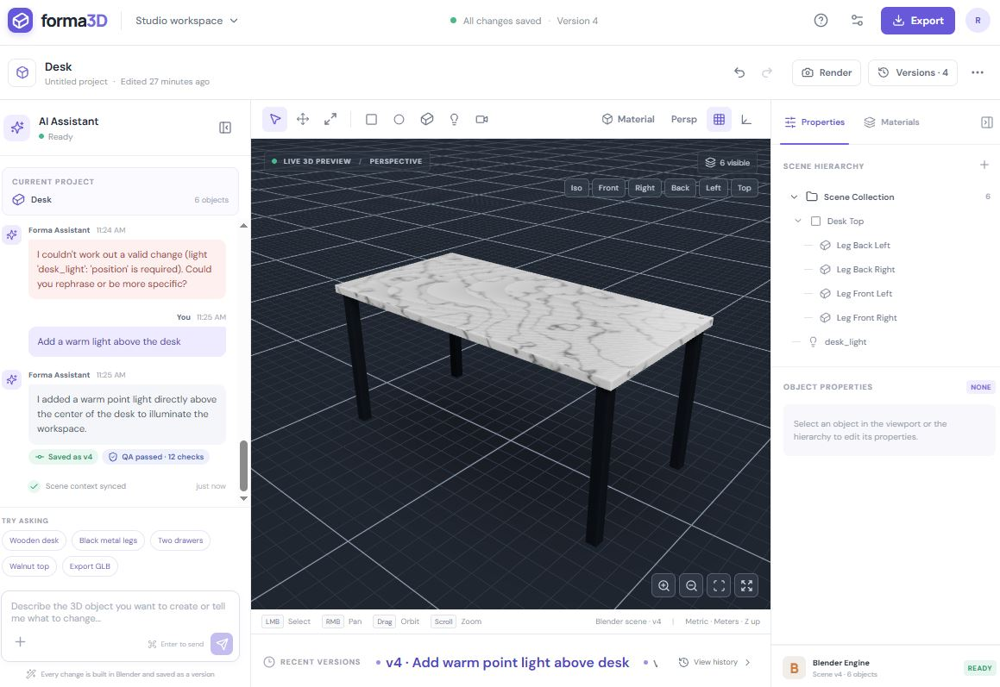
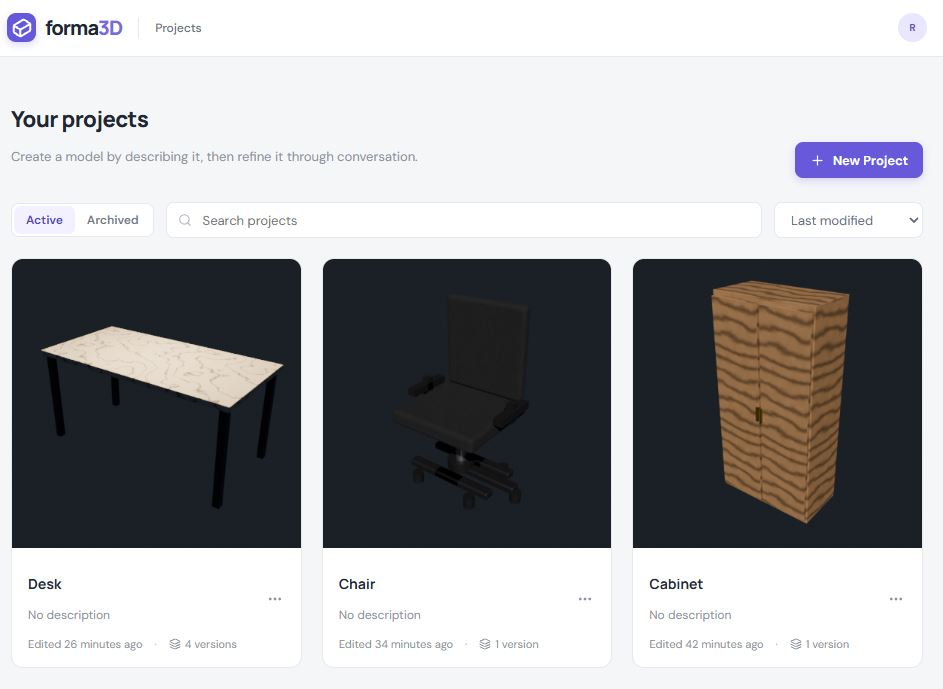
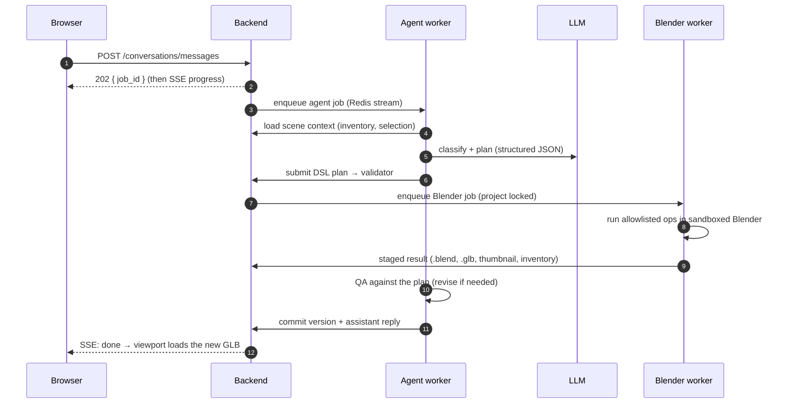

<p align="center">
  <picture>
    <source media="(prefers-color-scheme: dark)" srcset="docs/assets/logo-dark.svg">
    
  </picture>
</p>

<h3 align="center">Conversational AI 3D studio</h3>

<p align="center">
  Describe an object in plain language. AI agents plan it, Blender builds it, and you refine it in the browser:<br>
  by chatting, or by editing it directly. Every change becomes a version you can compare, undo or branch from.
</p>

<p align="center">
  
  
  
  
  
  
</p>

<p align="center">
  <a href="#features">Features</a> ·
  <a href="#screenshots">Screenshots</a> ·
  <a href="#architecture">Architecture</a> ·
  <a href="#deployment-with-docker">Deployment</a> ·
  <a href="#operations">Operations</a> ·
  <a href="#development">Development</a>
</p>

---

## Why forma3D

- **Talk to it like a designer.** "Create a modern wooden desk", "make the legs black metal", "add two drawers".
  Follow-ups understand the scene and the current selection.
- **Real geometry, not a picture.** Every model is a Blender scene you can download as `.blend`, GLB, glTF, OBJ
  or STL, or render with Cycles.
- **Safe by design.** The LLM never writes code. It produces a plan in a validated modeling language (DSL),
  and only allowlisted operations reach a sandboxed, headless Blender.
- **Self-hosted and private.** It runs on your own Docker host with your own LLM (vLLM or any OpenAI-compatible
  server). It also works fully offline or air-gapped.

## Screenshots

<p align="center">
  
  <br><sub><b>Workspace.</b> Chat with the assistant, inspect the live Blender scene, edit objects and step through versions.</sub>
</p>

<p align="center">
  
  <br><sub><b>Dashboard.</b> Your projects with live thumbnails, search, sort and archive.</sub>
</p>

## Features

### Conversational modeling
- Natural-language creation and editing, with clarifying questions when a request is ambiguous
  (for example "which drawer?").
- Selection-aware chat, so "make *this* taller" acts on whatever is selected in the viewport or tree.
- A multi-agent workflow (LangGraph):
  1. **Conversation** classifies the request.
  2. **Planning** writes the DSL.
  3. **Inspection** reads the scene.
  4. **QA** checks geometry, relations and untouched objects.
  5. **Revision** fixes failed checks.
- Live progress over server-sent events. Every reply shows its version and QA result ("Saved as v4 ·
  QA passed · 12 checks").
- Interrupted workflows resume from PostgreSQL checkpoints after a worker restart.

### 3D workspace
- Three.js / React Three Fiber viewport:
  - Orbit, pan and zoom, six camera presets, and perspective/orthographic views.
  - Solid, wireframe and material shading, plus grid and axes.
  - Fit-to-view and fullscreen.
- Click-to-select that stays in sync with the scene hierarchy. Multi-select is supported.
- Transform gizmo (move, rotate, scale) with exact numeric fields.
- Panels for properties, materials, lights and cameras.
- Add primitives, lights and cameras. Rename, hide and delete objects, and re-parent them.

### Modeling engine (51 DSL operations)
- Primitives, curves and custom meshes.
- Extrude and inset; booleans (union, difference, intersect).
- Modifiers: bevel, solidify, subdivide, mirror, array, remesh and decimate.
- Join and separate, origin and transform application, collections and parenting.
- PBR materials with glass (transmission), glow (emission) and procedural textures:
  wood, marble, brick, fabric, concrete, brushed metal and more. You can also upload your own images.
- Every operation is schema-checked and semantically validated (targets, limits, dependencies) before
  Blender runs.

### Versions and history
- Immutable versions with thumbnails, the message that created each one, and an inventory of the scene.
- Undo and redo, restore any version, and branch from the past.
- Compare two versions: objects and materials added, removed or changed, field by field.

### Output
- Export to **GLB, glTF, OBJ or STL**, in metres, centimetres or millimetres, optionally with hidden
  objects. Textures are included.
- **Cycles renders** at draft, standard or high quality, through any scene camera, with an optional
  transparent background. A GPU is used when one is available.
- Renders and exports can be started from chat ("render it", "export as STL").

### Accounts and projects
- Email and password accounts (argon2). Short-lived JWTs with rotating, reuse-detected refresh cookies.
- Projects can be created, renamed, duplicated, archived and deleted, with search and sorting.
  Each user's data is isolated.

### Production-ready operations
- Hardened containers:
  - Read-only root filesystems, no capabilities, non-root users.
  - Resource limits and isolated networks.
- Job recovery: crashed workers' jobs are re-run, stuck jobs time out cleanly and stale locks are released.
- Horizontal scaling of Blender and agent workers.
- Prometheus `/metrics`, a readiness endpoint and ready-made alert rules.
- Backup and restore scripts, retention policies, file-based secrets and an optional NVIDIA GPU profile.
- An offline bundle with image digests for air-gapped installs.

## Architecture


**What happens when you send a message**



| Component | Technology | Responsibility |
|---|---|---|
| **frontend** | React 18, TypeScript, Vite, React Three Fiber, TanStack Query, Zustand, nginx | SPA, 3D viewport, chat; nginx serves it and proxies `/api` with security headers |
| **backend** | FastAPI, SQLAlchemy 2 (async), Alembic, Pydantic, structlog | Auth, projects, conversations, the DSL validator, atomic version commits, SSE, maintenance, metrics |
| **agent-worker** | LangGraph, httpx, Postgres checkpointer | The multi-agent modeling workflow and the LLM provider abstraction (vLLM, OpenAI-compatible, offline fake) |
| **blender-worker** | Python 3.12 service + Blender 4.5 LTS (`bl_runtime`, stdlib + bpy only) | Runs validated operation batches, exports, renders and thumbnails in isolated job workspaces |
| **shared** | `forma3d_shared` (Pydantic) | One source of truth for the DSL, plans, jobs, events and inventory contracts |
| **postgres** / **redis** | PostgreSQL 17, Redis 7.4 | Durable state and LangGraph checkpoints / job streams, event replay, project locks, heartbeats |

Key design decisions:
- **Only the backend writes to the database.** Workers use token-authenticated internal endpoints.
- **Versions are immutable** and committed atomically: a directory rename plus one transaction, with
  optimistic concurrency on the head.
- **Stable object IDs** travel from Blender through glTF `extras` to the viewport, so a selection always maps
  to the same object across versions.
- **Every edit takes the same path.** Chat and direct UI edits both compile to DSL and go through the same
  validator and Blender pipeline.

More detail: [docs/architecture.md](docs/architecture.md) · DSL reference: [docs/modeling-dsl.md](docs/modeling-dsl.md) ·
HTTP API: [docs/api.md](docs/api.md)

## Deployment with Docker

> Full guide with HTTPS, overlays and the offline install: **[docs/deployment.md](docs/deployment.md)**

### Requirements
- A Linux host with **Docker Engine 24+** and the **compose plugin v2.20+**.
- **4 CPU cores and 8 GB RAM** minimum (8+ cores and 16 GB recommended), plus 20 GB of disk.
- An **OpenAI-compatible LLM endpoint** reachable from the host, for example vLLM serving an instruct model.
  Without one, set `LLM_PROVIDER=fake` to use the built-in demo planner.
- Optional: an NVIDIA GPU with the NVIDIA Container Toolkit, for faster renders.

### 1. Clone

```bash
git clone https://github.com/mkamranr/forma3d.git
cd forma3d
```

### 2. Configure

```bash
deployment/scripts/generate-secrets.sh    # creates .env with strong random secrets
nano .env                                 # set the LLM endpoint (below)
```

```dotenv
LLM_PROVIDER=vllm
LLM_BASE_URL=http://10.0.0.5:8000/v1    # reachable from the containers
LLM_MODEL=your-served-model-name
LLM_THINKING=off                        # reasoning models: much faster plans
COOKIE_SECURE=false                     # true once served over HTTPS
BLENDER_WORKERS=1                       # scale up for more parallel builds
```

### 3. Build and start

```bash
docker compose --env-file .env -f deployment/docker-compose.yml up -d --build
docker compose --env-file .env -f deployment/docker-compose.yml ps
```

The first build downloads and checksum-verifies Blender, which takes a few minutes. Services start in order
behind health checks:
1. postgres and redis
2. migrate (`alembic upgrade head`)
3. backend
4. the workers
5. frontend

### 4. Open the app

Browse to **`http://<docker-host>:3000`**, create an account, start a project and ask for a model:

> *Create a modern wooden desk with four black metal legs*

### Optional add-ons

Combine compose files with extra `-f` flags:

| Overlay | Adds |
|---|---|
| `deployment/docker-compose.secrets.yml` | Secrets from files under `/run/secrets` instead of `.env` (`generate-secrets.sh --files`) |
| `deployment/docker-compose.gpu.yml` | NVIDIA GPU rendering (OptiX/CUDA, with CPU fallback) |
| `deployment/docker-compose.monitoring.yml` | Prometheus with Forma3D alert rules on `127.0.0.1:9090` |

```bash
docker compose --env-file .env \
  -f deployment/docker-compose.yml \
  -f deployment/docker-compose.secrets.yml \
  -f deployment/docker-compose.gpu.yml \
  up -d
```

### Offline / air-gapped

```bash
# On a connected machine
deployment/scripts/offline-bundle.sh 1.0.0        # -> dist/forma3d-1.0.0.tar

# On the target host (Docker only)
tar -xf forma3d-1.0.0.tar && cd forma3d-1.0.0
deployment/scripts/offline-install.sh             # verifies checksums + image digests, then installs
```

### Services

| Service | Port | Networks | Notes |
|---|---|---|---|
| `frontend` | **3000** (published) | edge, app | The only published port |
| `backend` | 8000 (internal) | app, data | `/health`, `/health/ready`, `/metrics` |
| `agent-worker` | — | data, llm | The only service with outbound access (to the LLM) |
| `blender-worker` | — | data | `BLENDER_WORKERS` replicas, CPU/memory capped |
| `postgres`, `redis` | — | data | Persistent volumes |
| `migrate` | — | data | One-shot schema migration |

## Configuration

All settings live in `.env`. See [.env.example](.env.example) for the documented list. The most important ones:

| Variable | Default | Purpose |
|---|---|---|
| `LLM_PROVIDER` | `vllm` | `vllm`, `openai_compatible`, or `fake` (offline demo planner) |
| `LLM_BASE_URL` / `LLM_MODEL` | — | Endpoint and served model name |
| `LLM_MODEL_PLANNING` / `_CONVERSATION` / `_REVISION` | `LLM_MODEL` | Optional per-agent models |
| `LLM_STRUCTURED_OUTPUT` | `json_schema` | `json_schema`, `guided_json`, `json_object` or `none` |
| `LLM_THINKING` | `auto` | `on`/`off` for reasoning models (`chat_template_kwargs.enable_thinking`) |
| `AGENT_MAX_RETRIES` / `AGENT_MAX_REVISIONS` | `2` / `2` | Plan repair attempts / QA revision loops |
| `BLENDER_WORKERS`, `BLENDER_CPUS`, `BLENDER_MEMORY` | `1`, `2.0`, `4G` | Worker scale and limits |
| `JOB_TIMEOUT_SECONDS` / `RENDER_TIMEOUT_SECONDS` | `300` / `900` | Blender job limits |
| `MODELING_MAX_*` | 200 ops, 500 objects, 1M vertices | Validator limits |
| `DELETED_PROJECT_RETENTION_DAYS` / `OUTPUT_RETENTION_DAYS` | `30` / `30` | Retention (`0` keeps data forever) |
| `METRICS_TOKEN` | empty | Bearer token for `/metrics` |

## Operations

> Runbook: **[docs/operations.md](docs/operations.md)**

| Task | Command |
|---|---|
| Back up (database + project files, checksummed) | `deployment/scripts/backup.sh /srv/backups` |
| Restore | `deployment/scripts/restore.sh /srv/backups/forma3d-<timestamp>` |
| Upgrade | back up → `git pull` → `docker compose ... up -d --build` (migrations run automatically) |
| Scale | set `BLENDER_WORKERS=3` / `AGENT_WORKERS=2` in `.env` → `up -d` |
| Logs | `docker compose ... logs -f backend agent-worker blender-worker` (JSON, with job IDs) |
| Health | `GET /health/ready` → `ready` or `degraded` (workers, LLM, disk) |

Recovery is automatic:
- Jobs from a crashed worker are re-run by another worker.
- Jobs that never start or never finish are failed with a clear message.
- Abandoned results are discarded and orphaned project locks are released.

## Development

Run the whole app **without Docker**, using SQLite, an in-process Redis and a local Blender 4.5:

```bash
python -m venv backend/.venv
backend/.venv/bin/pip install -e shared -r backend/requirements-dev.txt \
  -r agent-worker/requirements-dev.txt -r blender-worker/requirements-dev.txt   # Windows: .venv/Scripts/pip

BLENDER_BIN=/path/to/blender \
LLM_BASE_URL=http://gpu-host:8000/v1 LLM_MODEL=<model> \
backend/.venv/bin/python deployment/scripts/dev_local.py     # API on :8000 (+ both workers)

cd frontend && npm ci && npm run dev                         # UI on :5173
```

Tests:

| Suite | Command | Notes |
|---|---|---|
| Shared contracts | `cd shared && python -m pytest -q` | DSL, validator, examples |
| Backend | `cd backend && python -m pytest -q` | SQLite + fakeredis, no services needed |
| Agent worker | `cd agent-worker && python -m pytest -q` | Deterministic fake LLM |
| Blender worker | `cd blender-worker && BLENDER_BIN=... python -m pytest -q` | Real Blender integration tests |
| Frontend | `cd frontend && npm test && npm run build` | Vitest + type check |

`make test` runs the Python suites inside the dev containers and the frontend tests locally.

### Repository layout

```
frontend/        React + TypeScript SPA (viewport, chat, panels) and nginx config
backend/         FastAPI app, models, Alembic migrations, services, maintenance, metrics
agent-worker/    LangGraph workflow, agents, prompts, LLM providers
blender-worker/  Job consumer + bl_runtime (runs inside Blender)
shared/          forma3d_shared: DSL, validator, job/event/inventory contracts, secrets
deployment/      Compose files, overlays, monitoring, operations scripts
docs/            Architecture, DSL, API, deployment and operations guides
```

## Roadmap status

| Phase | Scope | Status |
|---|---|---|
| 1 | Infrastructure, auth, projects, dashboard | ✅ |
| 2 | Blender worker, modeling DSL, validator, versioned commits | ✅ |
| 3 | Interactive workspace on real scenes | ✅ |
| 4 | LLM integration: the conversational vertical slice | ✅ |
| 5 | LangGraph multi-agent workflow (inspection, QA, clarification, revision, resume) | ✅ |
| 6 | Conversational editing and versioning (undo/redo, compare, branches) | ✅ |
| 7 | Advanced modeling, textures, cameras/lights, renders, exports | ✅ |
| 8 | Hardening, recovery, monitoring, backup, offline install | ✅ |

## Known limitations

- QA is geometric (dimensions, contacts, untouched objects). It does not judge aesthetics.
- Each edit is a Blender job, taking about 5–20 s on the CPU including the thumbnail. Edits to a project
  run one at a time.
- The viewport uses its own studio lighting. Blender lights affect renders only, and glass and glow are
  approximated in the browser.
- Procedural textures use box-projected UVs; there is no UV editor. STL exports carry geometry only.
- Booleans, join, remesh and decimate are destructive (undo restores the previous version).
- Eevee rendering needs a GPU and is off by default; Cycles always works.
- Duplicating a project copies its metadata, not its versions.
- The offline `fake` provider only understands the demo scenarios (desk, cabinet, office chair and their
  edits).
- The Linux container images and the Postgres checkpointer have not yet been run on the target Docker host.
  All suites pass locally, including the real-Blender suites (Blender 4.5.17 on Windows).
