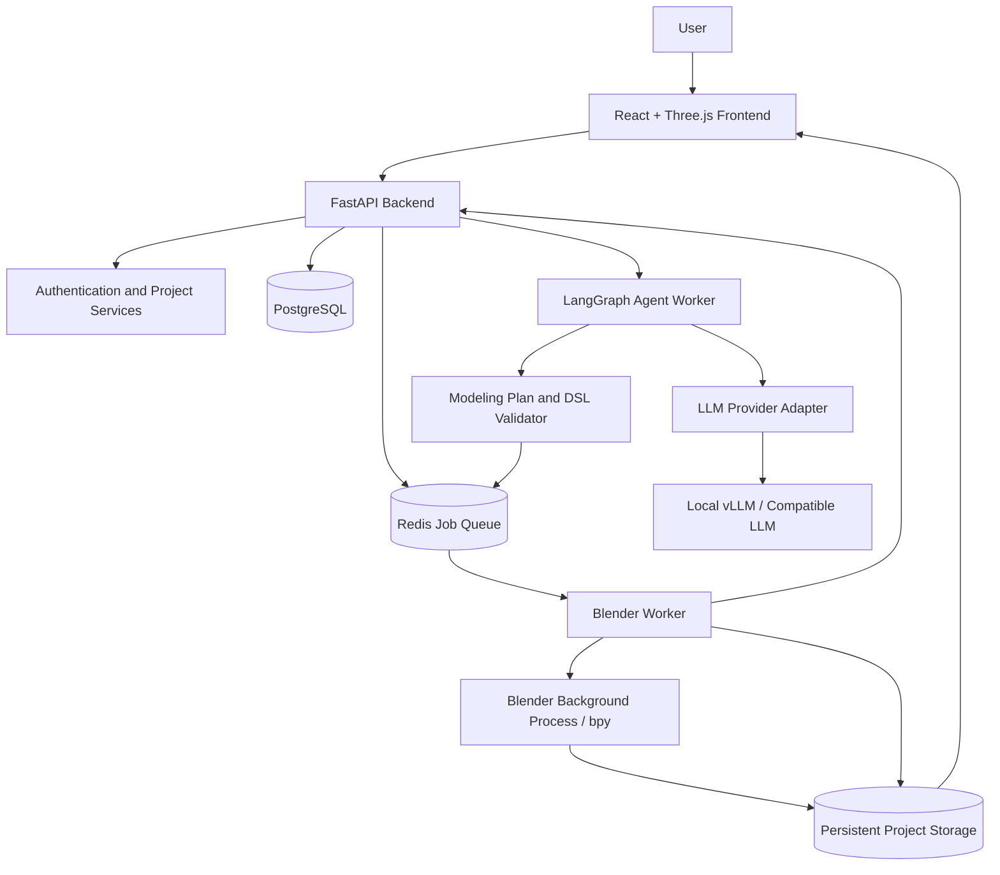
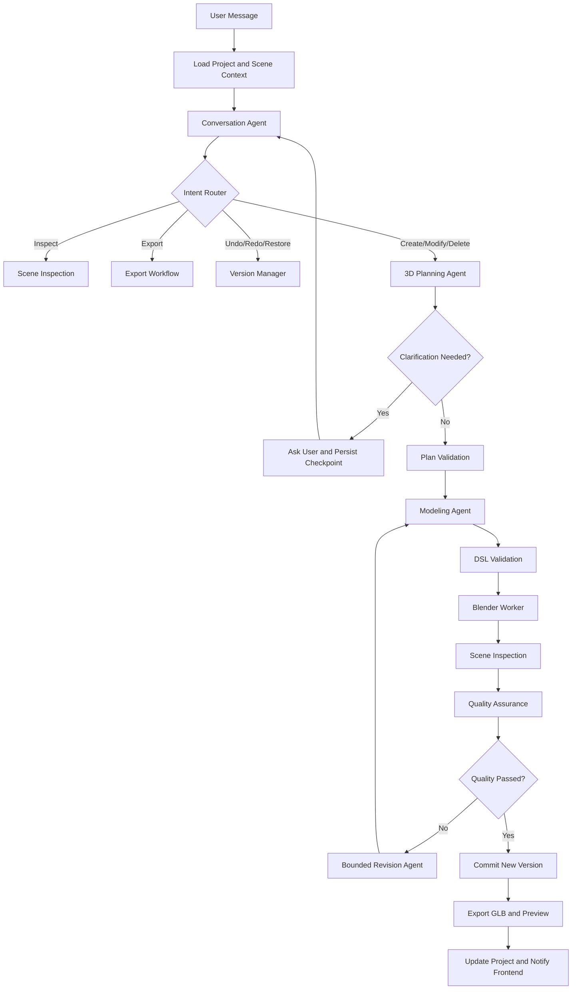

# 3D Studio --- Project Specification

## Conversational AI-Powered 3D Modeling with Blender

**Document type:** Product, architecture, and implementation
specification\
**Version:** 1.0\
**Status:** Initial implementation baseline\
**Primary deployment:** Docker Compose\
**Backend:** Python + FastAPI\
**Frontend:** React + TypeScript\
**3D engine:** Blender\
**Agent orchestration:** LangGraph\
**LLM integration:** Provider-independent, with local
vLLM/OpenAI-compatible support

------------------------------------------------------------------------

# 1. Executive Summary

3D Studio is a conversational AI-powered 3D modeling application. Users
describe an object or scene in natural language, an LLM interprets the
request, and an agent workflow converts it into validated modeling
operations that are executed by Blender.

Users can iteratively refine the same model through conversation. For
example:

1.  "Create a modern wooden office desk with four legs and two drawers."
2.  "Make the legs black metal."
3.  "Add rounded corners to the tabletop."
4.  "Make the tabletop 20% thicker."
5.  "Add handles to both drawers."

The application must preserve scene context, stable object identities,
conversation history, and model versions. Modifications should be
incremental: changing the legs must not rebuild or damage unrelated
parts of the desk.

The application runs in containers. Blender runs in a separate worker
container in background/headless mode. The browser displays exported GLB
assets using Three.js; users do not need Blender installed locally.

## 1.1 Product goals

-   Convert natural-language instructions into editable 3D geometry.
-   Generate models using Blender's Python API (`bpy`).
-   Support iterative conversational modifications.
-   Preserve unaffected geometry during modifications.
-   Provide an interactive browser-based 3D viewport.
-   Maintain project, conversation, operation, and version history.
-   Use specialized logical agents orchestrated by LangGraph.
-   Support local LLM inference through vLLM or another
    OpenAI-compatible endpoint.
-   Support standard 3D export formats.
-   Run the complete core application using Docker Compose.
-   Avoid mandatory cloud APIs, paid model APIs, or subscriptions.

## 1.2 Design principles

-   Treat Blender as a 3D execution engine, not as the application
    backend.
-   Use a structured, versioned modeling DSL instead of unrestricted
    LLM-generated Python.
-   Separate planning, validation, execution, inspection, and quality
    assurance.
-   Use deterministic operations wherever possible.
-   Maintain stable application-level object IDs.
-   Keep project versions immutable after commit.
-   Keep long-running work asynchronous.
-   Keep LLM providers replaceable.
-   Apply least-privilege security to generated instructions and worker
    execution.
-   Build incrementally, with a working end-to-end deliverable in every
    phase.

------------------------------------------------------------------------

# 2. Feasibility and Technology Assessment

## 2.1 Blender licensing and commercial use

Blender is free and open source under the GNU General Public License
(GPL). It can be used for commercial work, and there is no per-user
Blender runtime license fee.

Blender can be run inside Docker and automated without a graphical
interface. Its Python API supports object creation, mesh editing,
transformations, materials, modifiers, cameras, lights, rendering, scene
inspection, project saving, and export.

Official references:

-   Blender licensing: https://www.blender.org/about/license/
-   Blender Python API: https://docs.blender.org/api/current/
-   Blender FAQ: https://www.blender.org/support/faq/

**Licensing implementation note:** Keep Blender as a separate
executable/process or isolated worker service and review GPL obligations
before distributing Blender binaries, worker images, or scripts that
integrate with Blender. The application's own license and the licensing
of its Blender integration must be reviewed based on the actual
distribution model. This document is not legal advice.

## 2.2 Blender automation

The worker should use Blender's Python API (`bpy`) and background mode:

``` bash
blender --background --python /workspace/job_script.py
```

A typical automated job:

1.  Starts Blender in background mode.
2.  Loads a `.blend` project or initializes a new scene.
3.  Executes validated operations using `bpy`.
4.  Inspects the scene.
5.  Saves the updated `.blend` project.
6.  Exports a `.glb` file.
7.  Generates a preview image.
8.  Returns structured execution metadata.

Do not build a REST API inside Blender for the initial implementation. A
normal Python worker service should manage jobs and launch Blender
subprocesses. This provides better process isolation, timeouts, logging,
resource limits, and failure recovery.

## 2.3 Recommended core technologies

  Area                   Technology
  ---------------------- ----------------------------------------------------------
  Frontend               React + TypeScript + Vite
  UI components          Tailwind CSS + shadcn/ui
  3D viewport            Three.js + React Three Fiber + Drei
  Frontend state         Zustand
  Server state           TanStack Query
  Backend                Python 3.12+ + FastAPI
  Validation             Pydantic
  ORM and migrations     SQLAlchemy 2.x + Alembic
  Agent orchestration    LangGraph
  LLM integration        Provider adapter; OpenAI-compatible API
  Local inference        vLLM or compatible local server
  Database               PostgreSQL
  Queue/cache            Redis
  Job processing         Dedicated agent and Blender workers
  3D engine              Blender
  Browser model format   GLB/glTF
  Deployment             Docker Compose
  Testing                Pytest, frontend test tooling, Blender integration tests

Use compatible, pinned dependency versions. Verify the selected versions
together during Phase 1 rather than assuming every latest release is
compatible.

------------------------------------------------------------------------

# 3. Product Scope

## 3.1 MVP scope

The MVP must allow a user to:

1.  Register and log in.
2.  Create, open, rename, and delete projects.
3.  Open a modeling workspace.
4.  Describe an object in natural language.
5.  Have an LLM produce a structured modeling plan.
6.  Validate the plan against a modeling DSL.
7.  Execute the plan through Blender in Docker.
8.  Save a native `.blend` project.
9.  Export a GLB model.
10. View and manipulate the model in the browser.
11. Continue the conversation and modify the same model.
12. Select an object in the viewport and refer to it in a prompt.
13. View object hierarchy and supported properties.
14. Undo/redo by restoring committed versions.
15. Browse version history and restore a previous version.
16. Export the final model.

The MVP should demonstrate at least three complete scenarios:

-   Office desk.
-   Office chair.
-   Simple storage cabinet.

## 3.2 Initial modeling focus

Start with procedural objects that can be built reliably from
primitives, meshes, curves, modifiers, and materials:

-   Furniture.
-   Household objects.
-   Office equipment.
-   Simple architectural objects.
-   Product prototypes.
-   Basic mechanical assemblies.

Do not make highly detailed organic characters, advanced sculpting, or
complex mechanical CAD a requirement for the MVP.

## 3.3 Future scope

-   Image-to-3D and sketch-guided modeling.
-   Reference-image-guided modeling.
-   Geometry Nodes and parametric workflows.
-   Specialized furniture, architecture, mechanical, product, character,
    and environment agents.
-   Multi-object environments.
-   Importing user-provided assets.
-   Optional AI-generated 3D asset integration.
-   GPU rendering.
-   Multiple Blender workers and render workers.
-   Direct opening of generated `.blend` files in desktop Blender.

------------------------------------------------------------------------

# 4. High-Level Architecture

The application consists of these logical layers:

1.  **Frontend:** React workspace, conversation UI, viewport, hierarchy,
    properties, and version history.
2.  **API backend:** Authentication, projects, conversations, jobs,
    asset access, and version management.
3.  **Agent orchestrator:** LangGraph workflows and specialized logical
    agents.
4.  **LLM provider adapter:** Local vLLM or other configured
    OpenAI-compatible/provider APIs.
5.  **Modeling DSL and validator:** Strict schemas, allowlisted
    operations, limits, and authorization checks.
6.  **Blender worker:** Isolated job execution, scene inspection,
    saving, exporting, and preview rendering.
7.  **Persistence:** PostgreSQL, Redis, and persistent project file
    storage.

## 4.1 Logical architecture diagram



## 4.2 Service boundaries

### Frontend

Must not execute Blender or contain Blender-specific logic. It requests
operations through the backend and displays GLB files and job events.

### Backend

Owns application authorization, project metadata, conversations, job
creation, version commits, and asset access. It must not run long
Blender tasks in HTTP request handlers.

### Agent worker

Runs LangGraph workflows, calls the configured LLM, inspects scene
metadata, creates plans, and submits validated operation batches.

### Blender worker

Executes only validated operation batches. It must not accept arbitrary
Python or shell commands from the frontend or LLM.

### Storage

PostgreSQL stores metadata and structured application state. Redis
supports queues and transient coordination. Persistent filesystem
storage holds `.blend`, `.glb`, renders, thumbnails, and exports.

------------------------------------------------------------------------

# 5. User Experience and Frontend Specification

## 5.1 Design direction

The application must look like a professional creative productivity
tool, not a generic chatbot.

Design characteristics:

-   Light-first professional interface.
-   Neutral white and grey surfaces.
-   Subtle borders and restrained shadows.
-   Dark or neutral 3D viewport background for model contrast.
-   Restrained accent colors.
-   Clear typography and compact panels.
-   Strong visual hierarchy.
-   Responsive layout, optimized for desktop.

The 3D viewport must be the primary workspace element. The UI should not
be a large chatbot with a small model preview.

## 5.2 Main workspace layout

``` text
+----------------------------------------------------------------+
| Logo | Project Name | Save Status | Undo | Redo | Export | User |
+----------------------+--------------------------+--------------+
|                      |                          |              |
| AI Conversation      |       3D VIEWPORT        | Scene        |
|                      |                          | Hierarchy    |
| Messages             |  Orbit / Pan / Zoom       |--------------|
|                      |  Camera Presets           | Properties   |
| Agent Progress       |  Selection                |              |
|                      |                          | Materials    |
|                      |                          |              |
| Prompt Composer      |                          |              |
+----------------------+--------------------------+--------------+
| Version History / Recent Operations                            |
+----------------------------------------------------------------+
```

### Header

Include:

-   Application logo.
-   Project name.
-   Save/processing status.
-   Undo and redo.
-   Version history.
-   Export.
-   User profile.

### Left panel: conversation

Include:

-   User and assistant messages.
-   AI execution progress.
-   Agent activity indicators.
-   Multiline prompt composer.
-   Attachment control reserved for future image input.
-   Send button.
-   Stop/cancel execution button.
-   Selected-object context.
-   Conversation history.

Suggested placeholder:

> Describe the 3D object you want to create or tell me what to change...

### Center panel: viewport

Include:

-   Three.js canvas.
-   Orbit, pan, and zoom.
-   Fit model to viewport.
-   Front, back, left, right, top, and bottom views.
-   Perspective/orthographic toggle.
-   Object selection and highlighting.
-   Grid and axes.
-   Wireframe/solid/material display modes where supported.
-   Fullscreen.
-   Loading, empty, and error states.

### Right panel: scene explorer

Tabs:

1.  Hierarchy.
2.  Properties.
3.  Materials.

Hierarchy:

-   Collections and nested objects.
-   Expand/collapse.
-   Select object.
-   Show/hide.
-   Rename.
-   Delete with confirmation.

Properties:

-   Object name and stable ID.
-   Object type.
-   Position X/Y/Z.
-   Rotation X/Y/Z.
-   Scale X/Y/Z.
-   Dimensions X/Y/Z.
-   Parent.
-   Visibility.
-   Modifier information.
-   Mesh statistics where available.

Materials:

-   Assigned materials.
-   Base color.
-   Metallic.
-   Roughness.
-   Transparency where supported.

Direct UI edits must use the same validated operation pipeline as
conversational changes.

### Bottom panel: version history

Display:

-   Version number.
-   Operation summary.
-   Timestamp.
-   Status.
-   Restore action.

Allow the panel to expand to show full history.

## 5.3 Dashboard

Include:

-   New Project.
-   Recent projects.
-   Project thumbnails.
-   Project names and descriptions.
-   Last-modified time.
-   Version count.
-   Search and sorting.
-   Archive/delete actions.

Empty state: "Start creating your first 3D model."

## 5.4 Progress and error handling

Show real backend events for:

1.  Understanding request.
2.  Inspecting scene.
3.  Planning geometry.
4.  Generating operations.
5.  Validating plan.
6.  Building in Blender.
7.  Inspecting result.
8.  Generating preview.
9.  Saving version.

Do not fabricate percentages. Use actual stage events or indeterminate
progress.

On failure:

-   Preserve the last committed version.
-   Explain the failure in user-friendly language.
-   Provide retry where appropriate.
-   Record technical logs for diagnostics.
-   Never replace a valid scene with a partially executed failed scene.

------------------------------------------------------------------------

# 6. Conversational Modeling and Context

## 6.1 Supported intents

The Conversation Agent should classify requests into:

-   `CREATE`
-   `MODIFY`
-   `DELETE`
-   `INSPECT`
-   `EXPORT`
-   `UNDO`
-   `REDO`
-   `RESTORE`
-   `CLARIFY`
-   `GENERAL`

A new user message must not automatically mean a new scene. The agent
must use project and scene context.

## 6.2 Context supplied to the workflow

Provide only relevant context:

-   Current project metadata.
-   Conversation history, with a configurable context window or summary.
-   Current committed version ID.
-   Scene object inventory.
-   Object hierarchy.
-   Selected object IDs.
-   Recent operation batches.
-   Previous modeling plan when relevant.
-   Outstanding clarification or task state.

Persist conversation and workflow state. Do not depend on in-memory
agent state for continuity.

## 6.3 Stable object identity

Every application-created Blender object must have a stable
application-level ID. Do not rely on Blender-generated names.

Example inventory:

  Stable ID        Blender object name   Component
  ---------------- --------------------- -----------
  `desk_top`       Desk_Top              tabletop
  `leg_fl_01`      Leg_FL_01             leg
  `leg_fr_01`      Leg_FR_01             leg
  `drawer_left`    Drawer_Left           drawer
  `drawer_right`   Drawer_Right          drawer

Store IDs as Blender custom properties and in the application
database/inventory.

A request such as "make the right drawer smaller" must resolve to the
existing drawer. If multiple objects could match, ask the user to
clarify.

## 6.4 Incremental modifications

Supported operation categories:

-   Create.
-   Update.
-   Delete.
-   Inspect.
-   Duplicate.
-   Group/ungroup.
-   Move.
-   Rotate.
-   Scale.
-   Change dimensions.
-   Change material.
-   Add/remove modifiers.
-   Parent/unparent.
-   Rename.
-   Reposition.

The Revision Agent must identify the smallest affected object set and
avoid changing unrelated objects.

## 6.5 Versioning

Every successful modeling transaction creates an immutable version
containing:

-   Version ID.
-   Parent version ID.
-   Version number.
-   Operation batch ID.
-   Conversation message ID.
-   `.blend` path.
-   GLB path.
-   Thumbnail path.
-   Object inventory snapshot.
-   Operation summary.
-   Creation timestamp.
-   Status.

Support:

-   Undo.
-   Redo.
-   Restore previous version.
-   Compare versions.
-   Branch from previous version.
-   View conversation associated with a change.

For the MVP, undo/redo should restore version snapshots rather than
reverse arbitrary Blender operations.

------------------------------------------------------------------------

# 7. Agent Architecture with LangGraph

## 7.1 Agent design

Implement six logical agents as LangGraph nodes. They should share a
provider adapter and may use different prompts, schemas, and model
configurations. Do not deploy six independent LLM servers.

### Agent 1: Conversation Agent

Responsibilities:

-   Interpret natural-language requests.
-   Classify intent.
-   Resolve references to prior messages and objects.
-   Detect ambiguity.
-   Ask clarifying questions.
-   Prepare task context.

Inputs:

-   User message.
-   Conversation context.
-   Project metadata.
-   Current scene inventory.
-   Selected object IDs.

Outputs:

-   Intent.
-   Task description.
-   Target object IDs where known.
-   Clarification request if necessary.

### Agent 2: 3D Planning Agent

Responsibilities:

-   Decompose an object into components.
-   Determine dimensions and coordinate relationships.
-   Define object hierarchy and dependencies.
-   Choose geometry construction methods.
-   Define materials.
-   Define construction order.
-   Identify missing requirements.

Output: validated, structured modeling plan.

### Agent 3: Modeling Agent

Responsibilities:

-   Convert the modeling plan into DSL operations.
-   Resolve stable object IDs.
-   Select supported geometry operations.
-   Generate dependencies and expected effects.
-   Respect existing scene relationships.

The Modeling Agent must not execute Python or shell commands.

### Agent 4: Scene Inspection Agent

Use deterministic Blender inspection tools to retrieve:

-   Object inventory.
-   Object IDs and names.
-   Transforms and dimensions.
-   Materials.
-   Collections and hierarchy.
-   Modifiers.
-   Mesh statistics.
-   Relevant scene settings.

Use an LLM only when interpretation or summarization is needed.

### Agent 5: Quality Assurance Agent

Perform deterministic checks first:

-   Expected objects exist.
-   Dimensions are valid.
-   Transforms are within configured bounds.
-   Materials are assigned.
-   No unexpected objects were deleted.
-   No unexpected scene changes occurred.
-   Meshes pass structural checks.
-   Export artifacts exist and are readable.

Optionally use a vision-capable model to compare rendered previews with
the intended result. Visual inspection is advisory and must not replace
deterministic validation.

### Agent 6: Revision Agent

Responsibilities:

-   Compare requested changes with current scene state.
-   Identify target object IDs.
-   Generate minimal modification operations.
-   Define validation criteria.
-   Avoid rebuilding unaffected components.

## 7.2 LangGraph workflow



## 7.3 Workflow requirements

-   Use a persistent LangGraph checkpointer, PostgreSQL-backed in
    production.
-   Assign a unique thread ID to each workflow/conversation context.
-   Persist checkpoints and resumable state.
-   Use bounded retries and maximum graph iterations.
-   Add node-level timeouts.
-   Stream meaningful progress events.
-   Support human clarification checkpoints.
-   Record agent name, model, timing, status, and sanitized output
    metadata.
-   Do not let an agent bypass DSL validation.

## 7.4 Model routing

Allow model selection per agent:

-   Conversation: fast, smaller model.
-   Planning: stronger reasoning model.
-   Modeling: model with reliable structured output.
-   Inspection: deterministic tools; optional small model.
-   QA: deterministic checks; optional vision model.
-   Revision: reasoning model.

Model names and endpoints must be configuration, not hardcoded values.

------------------------------------------------------------------------

# 8. Modeling DSL and Validation

## 8.1 Core rule

The LLM must never submit unrestricted Python to Blender.

It produces structured operations using a versioned Domain-Specific
Language (DSL). The backend validates the plan and operation batch
before execution. Blender receives only validated, allowlisted
operations.

## 8.2 Initial operation registry

### Scene operations

-   `create_scene`
-   `inspect_scene`
-   `set_scene_units`
-   `set_scene_properties`

Avoid exposing destructive `clear_scene` as a normal conversational
operation. If supported for administrative or new-scene workflows,
require explicit authorization and safeguards.

### Geometry operations

-   `create_cube`
-   `create_sphere`
-   `create_cylinder`
-   `create_cone`
-   `create_torus`
-   `create_plane`
-   `create_circle`
-   `create_mesh`
-   `create_curve`
-   `extrude`
-   `bevel`
-   `inset`
-   `boolean_union`
-   `boolean_difference`
-   `boolean_intersect`
-   `subdivide`
-   `mirror`
-   `array`
-   `solidify`
-   `remesh`
-   `decimate`

### Transform operations

-   `move_object`
-   `rotate_object`
-   `scale_object`
-   `set_dimensions`
-   `apply_transform`
-   `set_origin`

### Object operations

-   `duplicate_object`
-   `delete_object`
-   `rename_object`
-   `parent_object`
-   `unparent_object`
-   `join_objects`
-   `separate_objects`
-   `set_visibility`
-   `create_collection`
-   `move_to_collection`

### Material operations

-   `create_material`
-   `assign_material`
-   `update_material`
-   `set_base_color`
-   `set_metallic`
-   `set_roughness`
-   `set_transparency`
-   `assign_texture`

### Camera and lighting operations

-   `add_camera`
-   `update_camera`
-   `add_light`
-   `update_light`
-   `set_world_background`

### Export operations

-   `export_glb`
-   `export_gltf`
-   `export_obj`
-   `export_stl`

Each operation must have a documented schema, implementation, unit
tests, and explicit allowlist registration.

## 8.3 Operation schema

Each operation should contain:

-   `operation_id`
-   `operation_type`
-   `target_object_id` where applicable
-   `parameters`
-   `dependencies`
-   `metadata`

Example:

``` json
{
  "operation_id": "op_001",
  "operation_type": "create_cube",
  "target_object_id": "desk_top",
  "parameters": {
    "name": "Desk Top",
    "dimensions": [2.0, 1.0, 0.12],
    "location": [0.0, 0.0, 1.0]
  },
  "dependencies": [],
  "metadata": {
    "component": "tabletop"
  }
}
```

Example modification:

``` json
{
  "operation_id": "op_014",
  "operation_type": "set_dimensions",
  "target_object_id": "desk_top",
  "parameters": {
    "dimensions": [2.0, 1.0, 0.15]
  },
  "dependencies": [],
  "metadata": {
    "reason": "Increase tabletop thickness"
  }
}
```

## 8.4 Modeling plan schema

A modeling plan must contain:

-   `plan_id`
-   `schema_version`
-   `task_type`
-   `scene_id`
-   `units`
-   `components`
-   `relationships`
-   `ordered_operations`
-   `expected_result`
-   `validation_criteria`

Use Pydantic models in the shared schema package. Include schema
versioning and migration/compatibility strategy.

## 8.5 Validation requirements

Before execution:

1.  Validate JSON/Pydantic schema.
2.  Check operation type against allowlist.
3.  Check required and allowed parameters.
4.  Validate numeric values, dimensions, and coordinate ranges.
5.  Validate target object references.
6.  Validate dependencies and operation ordering.
7.  Validate project and user authorization.
8.  Enforce operation-count and scene-complexity limits.
9.  Reject executable code, imports, shell commands, and unknown fields.
10. Create an immutable validated operation batch.

Apply configurable limits for:

-   Operations per batch.
-   New objects per batch.
-   Total scene objects.
-   Mesh vertex and face counts.
-   Modifier iterations.
-   Texture dimensions and sizes.
-   Render resolution.
-   Job execution time.
-   Output file size.

Never accept arbitrary file paths from an LLM. Resolve all project
assets through server-controlled IDs and paths.

## 8.6 Transactional execution

Execute each operation batch against a working copy of the latest
committed `.blend` version.

On failure:

-   Preserve the last committed version.
-   Record the failing operation and error.
-   Capture Blender logs.
-   Discard or quarantine incomplete output.
-   Report a structured failure to the orchestrator.

Commit only after structural validation and required exports succeed.
Use atomic filesystem writes and a database transaction for the version
pointer/metadata update. Design recovery for a crash between file
creation and database commit.

------------------------------------------------------------------------

# 9. Blender Worker Specification

## 9.1 Container contents

Build an independent Blender worker image containing:

-   A pinned official Blender release.
-   Required system dependencies.
-   Worker service code.
-   Modeling DSL executor.
-   Operation registry.
-   Scene inspector.
-   Mesh validator.
-   Export manager.
-   Render manager.

Avoid unnecessary third-party Blender add-ons in the MVP.

Do not rely on an unverified third-party Blender image. Build and test
the image from a verified Blender distribution.

## 9.2 Worker lifecycle

1.  Acquire a job from the queue.
2.  Validate job metadata and project ownership context supplied by the
    trusted backend.
3.  Create an isolated job workspace.
4.  Retrieve the source committed version.
5.  Verify source file/checksum.
6.  Launch Blender in background mode.
7.  Load the `.blend` file or initialize a scene.
8.  Execute the validated operation batch.
9.  Run structural checks.
10. Save a new working `.blend`.
11. Export GLB.
12. Generate a thumbnail or preview when requested.
13. Validate output artifacts.
14. Write structured execution result.
15. Report completion or failure.
16. Clean up temporary files according to retention policy.

Use one Blender process per job for the MVP. Do not share a mutable
Blender process between unrelated projects or concurrent users.

## 9.3 Blender process control

The worker must implement:

-   Process timeout.
-   Cancellation.
-   Graceful termination followed by forced termination if needed.
-   CPU and memory limits at container level.
-   Captured stdout/stderr.
-   Structured result file.
-   Exit-code handling.
-   Output artifact validation.
-   Job-specific workspace.
-   Idempotency/job deduplication strategy.

Example subprocess pattern:

``` python
import subprocess

def execute_blender_script(script_path: str, timeout: int = 300):
    result = subprocess.run(
        [
            "blender",
            "--background",
            "--python",
            script_path,
        ],
        capture_output=True,
        text=True,
        timeout=timeout,
        check=False,
    )

    if result.returncode != 0:
        raise RuntimeError(
            f"Blender failed with exit code {result.returncode}: "
            f"{result.stderr[-4000:]}"
        )

    return {
        "success": True,
        "stdout": result.stdout,
        "stderr": result.stderr,
    }
```

Production code must additionally handle timeouts, cancellation, process
cleanup, output validation, and log redaction.

## 9.4 Blender worker modules

``` text
blender-worker/
  app/
    executor/
      operation_executor.py
      operation_registry.py
    geometry/
      object_factory.py
      geometry_builder.py
      mesh_operations.py
    scene/
      scene_manager.py
      scene_inspector.py
    materials/
      material_manager.py
    modifiers/
      modifier_manager.py
    transforms/
      transform_manager.py
    collections/
      collection_manager.py
    exporters/
      export_manager.py
    rendering/
      render_manager.py
    validation/
      mesh_validator.py
    worker.py
```

## 9.5 Object metadata

Every application-created object must have custom properties:

-   `app_object_id`
-   `app_project_id`
-   `app_component_type`
-   `app_created_version`
-   `app_last_modified_version`
-   `app_parent_id`

Metadata must be preserved across save/load and export where the target
format supports it. The database inventory remains the authoritative
application record.

## 9.6 Rendering

MVP:

-   CPU geometry generation.
-   CPU thumbnail rendering.
-   Configurable preview resolution.

Later:

-   Eevee and Cycles profiles.
-   Optional NVIDIA GPU rendering.
-   Dedicated render queue and workers.
-   GPU-aware scheduling.

Geometry creation and basic scene editing must not require a GPU. GPU
rendering requires compatible host drivers, container GPU access, and
Blender build support.

------------------------------------------------------------------------

# 10. LLM Provider Integration

## 10.1 Provider abstraction

Create a provider-independent interface with methods such as:

-   `generate_text()`
-   `generate_structured()`
-   `classify_intent()`
-   `generate_modeling_plan()`
-   `inspect_scene()`
-   `revise_plan()`

The agent layer must not depend directly on a specific vendor SDK.

## 10.2 Initial provider

Support an OpenAI-compatible API, including local vLLM.

Example configuration:

``` env
LLM_PROVIDER=vllm
LLM_BASE_URL=http://llm-server:8000/v1
LLM_MODEL=your-instruct-model
LLM_API_KEY=local-token

LLM_TEMPERATURE=0.2
LLM_MAX_TOKENS=8192
LLM_TIMEOUT_SECONDS=120

AGENT_MAX_RETRIES=2
AGENT_MAX_ITERATIONS=8
```

Use environment-specific configuration. Do not commit secrets.

## 10.3 Structured output reliability

Do not assume every model reliably follows JSON instructions.

Implement:

-   Pydantic validation.
-   Structured-output mode where supported.
-   Bounded repair/retry prompts.
-   Maximum output size.
-   Schema version checks.
-   Clear validation errors.
-   Safe failure when the model repeatedly returns invalid output.

The LLM must never be able to bypass the DSL validator.

------------------------------------------------------------------------

# 11. Database Design

Use PostgreSQL, SQLAlchemy 2.x, and Alembic migrations. Use UUID primary
keys, UTC timestamps, appropriate indexes, foreign keys, and JSONB for
flexible metadata. Do not store large binary model files in PostgreSQL.

## 11.1 `users`

-   `id`: UUID, primary key
-   `email`: unique
-   `password_hash`
-   `display_name`
-   `is_active`
-   `created_at`
-   `updated_at`

## 11.2 `projects`

-   `id`: UUID, primary key
-   `user_id`: foreign key
-   `name`
-   `description`
-   `thumbnail_path`
-   `current_version_id`
-   `status`
-   `created_at`
-   `updated_at`

## 11.3 `conversations`

-   `id`: UUID, primary key
-   `project_id`: foreign key
-   `user_id`: foreign key
-   `title`
-   `langgraph_thread_id`
-   `created_at`
-   `updated_at`

## 11.4 `messages`

-   `id`: UUID, primary key
-   `conversation_id`: foreign key
-   `role`
-   `content`
-   `intent`
-   `status`
-   `metadata`: JSONB
-   `created_at`

## 11.5 `scene_versions`

-   `id`: UUID, primary key
-   `project_id`: foreign key
-   `parent_version_id`
-   `version_number`
-   `blend_file_path`
-   `glb_file_path`
-   `thumbnail_path`
-   `operation_batch_id`
-   `object_inventory`: JSONB
-   `summary`
-   `status`
-   `created_at`

## 11.6 `scene_objects`

-   `id`: UUID, primary key
-   `project_id`: foreign key
-   `blender_object_id`
-   `parent_object_id`
-   `object_name`
-   `object_type`
-   `component_type`
-   `properties`: JSONB
-   `is_active`
-   `created_at`
-   `updated_at`

## 11.7 `modeling_plans`

-   `id`: UUID, primary key
-   `project_id`: foreign key
-   `conversation_id`
-   `message_id`
-   `plan_data`: JSONB
-   `status`
-   `created_at`

## 11.8 `operation_batches`

-   `id`: UUID, primary key
-   `project_id`: foreign key
-   `version_id`
-   `modeling_plan_id`
-   `operations`: JSONB
-   `validation_result`: JSONB
-   `execution_status`
-   `created_at`
-   `completed_at`

## 11.9 `jobs`

-   `id`: UUID, primary key
-   `project_id`: foreign key
-   `operation_batch_id`
-   `job_type`
-   `status`
-   `progress`
-   `worker_id`
-   `error_message`
-   `started_at`
-   `completed_at`
-   `created_at`

## 11.10 `assets`

-   `id`: UUID, primary key
-   `project_id`: foreign key
-   `version_id`
-   `asset_type`
-   `file_path`
-   `file_size`
-   `checksum`
-   `metadata`: JSONB
-   `created_at`

## 11.11 `agent_runs`

-   `id`: UUID, primary key
-   `project_id`: foreign key
-   `conversation_id`
-   `job_id`
-   `agent_name`
-   `model_name`
-   `input_metadata`: JSONB
-   `output_metadata`: JSONB
-   `status`
-   `duration_ms`
-   `error_message`
-   `created_at`

## 11.12 Database requirements

-   Enforce project ownership in every repository/service query.
-   Add indexes on `project_id`, `user_id`, `conversation_id`, and
    `status`.
-   Use transactions for version metadata and current-version pointer
    updates.
-   Keep workflow checkpoints persistent.
-   Define deletion and retention behavior.
-   Avoid storing secrets or unnecessary sensitive prompts in logs.
-   Consider optimistic concurrency/version checks to prevent two jobs
    modifying the same project head simultaneously.

------------------------------------------------------------------------

# 12. File Storage

Use a persistent filesystem volume for the MVP. Keep storage access
behind an asset-storage abstraction so S3-compatible object storage can
be added later.

Suggested layout:

``` text
/data/
  projects/
    {user_id}/
      {project_id}/
        project.json
        versions/
          v0001/
            scene.blend
            scene.glb
            thumbnail.png
            inventory.json
            operations.json
          v0002/
            scene.blend
            scene.glb
            thumbnail.png
            inventory.json
            operations.json
        renders/
          render_001.png
        exports/
          model.stl
          model.obj
        backups/
```

Requirements:

-   Isolate every project directory.
-   Generate filenames server-side.
-   Never accept arbitrary storage paths from an LLM or user.
-   Validate ownership for every asset request.
-   Verify checksums.
-   Use atomic writes.
-   Preserve committed versions.
-   Define temporary-file cleanup and retention policies.
-   Support backup and restore.
-   Do not expose raw filesystem paths to the frontend.

------------------------------------------------------------------------

# 13. API Specification

Use REST APIs for application operations and Server-Sent Events (SSE)
for long-running job updates. All endpoints require authentication
except registration and login.

## 13.1 Authentication

-   `POST /api/v1/auth/register`
-   `POST /api/v1/auth/login`
-   `POST /api/v1/auth/refresh`
-   `POST /api/v1/auth/logout`
-   `GET /api/v1/auth/me`

Use secure password hashing, short-lived access tokens, refresh-token
rotation/revocation, and secure cookie or token storage appropriate to
the deployment.

## 13.2 Projects

-   `GET /api/v1/projects`
-   `POST /api/v1/projects`
-   `GET /api/v1/projects/{project_id}`
-   `PUT /api/v1/projects/{project_id}`
-   `DELETE /api/v1/projects/{project_id}`
-   `POST /api/v1/projects/{project_id}/duplicate`

## 13.3 Conversations

-   `GET /api/v1/projects/{project_id}/conversations`
-   `POST /api/v1/projects/{project_id}/conversations`
-   `GET /api/v1/conversations/{conversation_id}/messages`
-   `POST /api/v1/conversations/{conversation_id}/messages`

Main conversational request:

``` json
{
  "content": "Create a modern wooden office desk",
  "selected_object_ids": [],
  "attachments": []
}
```

Initial response:

``` json
{
  "message_id": "uuid",
  "job_id": "uuid",
  "status": "queued"
}
```

The endpoint should enqueue work and return quickly.

## 13.4 Modeling

-   `POST /api/v1/projects/{project_id}/modeling/create`
-   `POST /api/v1/projects/{project_id}/modeling/modify`
-   `POST /api/v1/projects/{project_id}/modeling/inspect`
-   `POST /api/v1/projects/{project_id}/modeling/execute`
-   `POST /api/v1/projects/{project_id}/modeling/undo`
-   `POST /api/v1/projects/{project_id}/modeling/redo`

The conversational endpoint should be the primary user-facing workflow.
Specialized endpoints may be used by the UI or integrations, but must
share the same validation and job pipeline.

## 13.5 Jobs

-   `GET /api/v1/jobs/{job_id}`
-   `POST /api/v1/jobs/{job_id}/cancel`
-   `GET /api/v1/jobs/{job_id}/events`

SSE event types:

-   `job.started`
-   `agent.started`
-   `agent.progress`
-   `plan.created`
-   `plan.validated`
-   `blender.started`
-   `blender.progress`
-   `blender.completed`
-   `quality.completed`
-   `version.created`
-   `asset.ready`
-   `job.completed`
-   `job.failed`

SSE events must be authorized against the owning user/project.

## 13.6 Scene

-   `GET /api/v1/projects/{project_id}/scene`
-   `GET /api/v1/projects/{project_id}/scene/objects`
-   `GET /api/v1/projects/{project_id}/scene/objects/{object_id}`
-   `PUT /api/v1/projects/{project_id}/scene/objects/{object_id}`
-   `DELETE /api/v1/projects/{project_id}/scene/objects/{object_id}`
-   `GET /api/v1/projects/{project_id}/scene/hierarchy`

## 13.7 Versions

-   `GET /api/v1/projects/{project_id}/versions`
-   `GET /api/v1/projects/{project_id}/versions/{version_id}`
-   `POST /api/v1/projects/{project_id}/versions/{version_id}/restore`
-   `POST /api/v1/projects/{project_id}/versions/compare`

## 13.8 Exports

-   `POST /api/v1/projects/{project_id}/exports`
-   `GET /api/v1/exports/{export_id}`
-   `GET /api/v1/exports/{export_id}/download`

Validate export formats against an allowlist.

------------------------------------------------------------------------

# 14. Docker and Deployment

## 14.1 Required containers

-   `frontend`
-   `backend`
-   `agent-worker`
-   `blender-worker`
-   `postgres`
-   `redis`

Optional later services:

-   Dedicated `render-worker`.
-   S3-compatible object storage.
-   Monitoring stack.
-   External authentication provider.

## 14.2 Compose architecture

A starting point:

``` yaml
services:
  frontend:
    build: ./frontend
    ports:
      - "3000:3000"
    depends_on:
      - backend

  backend:
    build: ./backend
    ports:
      - "8000:8000"
    depends_on:
      - postgres
      - redis

  agent-worker:
    build: ./agent-worker
    depends_on:
      - redis
      - backend

  blender-worker:
    build: ./blender-worker
    volumes:
      - project_data:/workspace
    depends_on:
      - redis

  postgres:
    image: postgres:17
    volumes:
      - postgres_data:/var/lib/postgresql/data

  redis:
    image: redis:7-alpine
    volumes:
      - redis_data:/data

volumes:
  postgres_data:
  redis_data:
  project_data:
```

This is an architectural starting point, not a production-ready Compose
file. The coding agent must add pinned image versions or digests, health
checks, private networks, resource constraints, non-root users where
practical, secrets handling, and correct service readiness dependencies.

The LLM endpoint may be on another host or container network. It must be
configurable.

## 14.3 Network architecture

-   Keep backend, workers, PostgreSQL, and Redis on private internal
    networks.
-   Expose only the frontend/reverse proxy and required API routes.
-   Do not expose PostgreSQL, Redis, or Blender worker ports publicly.
-   Blender worker must accept jobs only from trusted internal
    infrastructure.
-   Do not mount the Docker socket into application or worker
    containers.

## 14.4 Resource management

Configurable limits:

-   Blender CPU.
-   Blender memory.
-   Maximum concurrent jobs.
-   Maximum scene complexity.
-   Render resolution.
-   Job timeout.
-   LLM timeout.
-   Output file size.
-   Worker retry count.

Start with one active Blender job at a time. Add worker concurrency only
after workspace isolation and project locking are proven.

## 14.5 GPU profile

Initial release:

-   CPU geometry generation.
-   CPU preview rendering.

Future optional profile:

-   NVIDIA container runtime.
-   GPU-enabled Blender rendering.
-   GPU-aware worker scheduling.
-   Separate render workers.

Do not make GPU access a requirement for basic modeling.

## 14.6 Air-gapped deployment readiness

Core application design should support offline/isolated deployments:

-   Pin Python and npm dependencies.
-   Pin container images.
-   Build and test images on an internet-connected staging machine.
-   Export images and dependencies into a transfer bundle.
-   Avoid CDN assets, runtime downloads, telemetry, and external font
    dependencies.
-   Configure LLM endpoint locally.
-   Document offline installation, upgrades, and backup/restore.
-   Ensure Blender and all required add-ons/dependencies are present in
    the image.

------------------------------------------------------------------------

# 15. Security

Assume all LLM-generated content is untrusted.

Mandatory controls:

1.  No unrestricted Python execution from LLM output.
2.  No arbitrary shell commands.
3.  No arbitrary imports.
4.  Strict operation schemas and allowlists.
5.  Validate numeric ranges and scene complexity.
6.  Validate object references.
7.  Enforce user/project ownership.
8.  Isolate Blender job workspaces.
9.  Apply worker timeouts and CPU/memory limits.
10. Do not expose Blender worker APIs publicly.
11. Do not mount Docker socket into workers.
12. Restrict container filesystem access.
13. Validate imported assets before processing.
14. Generate all storage paths server-side.
15. Secure asset download endpoints.
16. Keep previous successful versions immutable.
17. Protect secrets and redact them from logs.
18. Rate-limit expensive job submission.
19. Prevent concurrent jobs from silently overwriting the same project
    version.
20. Treat reference files and imported model metadata as untrusted
    input.

Run containers with least privilege. Use read-only filesystems where
feasible and grant write access only to job-specific workspaces and
required persistent volumes.

------------------------------------------------------------------------

# 16. Logging, Monitoring, and Health

Use structured logs with correlation IDs.

Track:

-   User ID.
-   Project ID.
-   Conversation ID.
-   Job ID.
-   Agent name.
-   LLM model.
-   Blender worker ID.
-   Operation count.
-   Execution duration.
-   Render duration.
-   Export duration.
-   Failure reason.

Do not log passwords, tokens, API keys, or unnecessary sensitive prompt
content.

Health endpoints:

-   `GET /health`
-   `GET /health/ready`

Monitor:

-   API availability.
-   PostgreSQL connectivity.
-   Redis connectivity.
-   LLM connectivity.
-   Blender executable availability.
-   Blender worker availability.
-   Queue depth.
-   Active jobs.
-   Failed jobs.
-   Worker resource usage.
-   Disk usage.
-   Artifact generation failures.

------------------------------------------------------------------------

# 17. Testing Strategy

## 17.1 Unit tests

Test:

-   Modeling DSL schemas.
-   Operation validation.
-   Object ID resolution.
-   Intent routing.
-   Project ownership.
-   Version management.
-   Asset path validation.
-   Agent state transitions.
-   Provider adapter behavior.
-   Database repositories.
-   Job state transitions.

## 17.2 Blender integration tests

Run automated background Blender tests for:

1.  Create cube.
2.  Create sphere.
3.  Create cylinder.
4.  Create multiple objects.
5.  Apply transformations.
6.  Apply bevel modifier.
7.  Create material.
8.  Assign material.
9.  Duplicate object.
10. Delete object.
11. Save and reload scene.
12. Preserve custom object metadata.
13. Export GLB.
14. Inspect exported GLB.
15. Generate thumbnail.
16. Handle invalid operations without damaging committed versions.

## 17.3 Conversational tests

Scenario A:

-   Create desk.
-   Change material.
-   Modify dimensions.
-   Add drawer.
-   Export model.

Scenario B:

-   Create chair.
-   Select backrest.
-   Modify backrest.
-   Change color.
-   Restore previous version.

Scenario C:

-   Create table.
-   Ask ambiguous modification.
-   Verify clarification.
-   Continue after clarification.

Scenario D:

-   Submit invalid modeling operation.
-   Verify rejection.
-   Verify previous scene remains intact.

Scenario E:

-   Submit two modifications concurrently.
-   Verify project locking/version conflict handling prevents lost
    updates.

## 17.4 End-to-end tests

Test:

-   Registration and login.
-   Project creation.
-   Conversation creation.
-   Model generation.
-   Job event streaming.
-   Viewport update.
-   Object selection.
-   Conversational modification.
-   Version creation.
-   Undo/redo.
-   Export/download.
-   Project reload after container restart.

------------------------------------------------------------------------

# 18. Performance and Scalability

Initial targets under normal development conditions:

-   Ordinary metadata API response: under 500 ms.
-   Modeling job submission: under 500 ms.
-   Long-running modeling: always asynchronous.
-   Typical optimized MVP GLB viewport load: target under 5 seconds on a
    reasonable desktop connection.
-   No frontend blocking during Blender execution.
-   No loss of committed versions after worker failure.

Actual generation time depends on the model, LLM latency, geometry
complexity, CPU/GPU resources, and rendering settings.

Scaling path:

-   Phase 1: one Blender worker, one active job.
-   Phase 2: multiple workers with isolated workspaces and project
    locks.
-   Phase 3: separate modeling and rendering queues.
-   Phase 4: GPU-aware scheduling and workload prioritization.

Do not introduce Kubernetes in the initial implementation. Docker
Compose is sufficient.

------------------------------------------------------------------------

# 19. Repository Structure

Use a modular monorepo:

``` text
3d-studio/
├── frontend/
│   ├── public/
│   ├── src/
│   │   ├── app/
│   │   ├── components/
│   │   │   ├── layout/
│   │   │   ├── chat/
│   │   │   ├── viewport/
│   │   │   ├── hierarchy/
│   │   │   ├── properties/
│   │   │   ├── materials/
│   │   │   └── versions/
│   │   ├── features/
│   │   │   ├── auth/
│   │   │   ├── projects/
│   │   │   ├── conversations/
│   │   │   ├── modeling/
│   │   │   └── exports/
│   │   ├── hooks/
│   │   ├── services/
│   │   ├── stores/
│   │   ├── types/
│   │   ├── utils/
│   │   └── styles/
│   ├── Dockerfile
│   └── package.json
├── backend/
│   ├── app/
│   │   ├── api/v1/
│   │   ├── core/
│   │   ├── auth/
│   │   ├── database/
│   │   ├── models/
│   │   ├── schemas/
│   │   ├── repositories/
│   │   ├── services/
│   │   ├── integrations/
│   │   │   ├── llm/
│   │   │   ├── redis/
│   │   │   └── blender/
│   │   ├── middleware/
│   │   └── main.py
│   ├── migrations/
│   ├── tests/
│   ├── Dockerfile
│   └── requirements.txt
├── agent-worker/
│   ├── app/
│   │   ├── agents/
│   │   │   ├── conversation_agent.py
│   │   │   ├── planning_agent.py
│   │   │   ├── modeling_agent.py
│   │   │   ├── inspection_agent.py
│   │   │   ├── quality_agent.py
│   │   │   └── revision_agent.py
│   │   ├── graphs/
│   │   │   ├── modeling_graph.py
│   │   │   ├── state.py
│   │   │   └── routing.py
│   │   ├── prompts/
│   │   ├── schemas/
│   │   ├── tools/
│   │   ├── providers/
│   │   ├── memory/
│   │   ├── workers/
│   │   └── main.py
│   ├── tests/
│   ├── Dockerfile
│   └── requirements.txt
├── blender-worker/
│   ├── app/
│   │   ├── executor/
│   │   ├── geometry/
│   │   ├── scene/
│   │   ├── materials/
│   │   ├── modifiers/
│   │   ├── transforms/
│   │   ├── collections/
│   │   ├── exporters/
│   │   ├── rendering/
│   │   ├── validation/
│   │   └── worker.py
│   ├── scripts/
│   ├── tests/
│   ├── Dockerfile
│   └── requirements.txt
├── shared/
│   ├── schemas/
│   │   ├── modeling_plan.py
│   │   ├── modeling_operation.py
│   │   ├── scene_object.py
│   │   └── job.py
│   ├── contracts/
│   └── constants/
├── deployment/
│   ├── docker-compose.yml
│   ├── docker-compose.dev.yml
│   ├── docker-compose.gpu.yml
│   ├── nginx/
│   └── scripts/
├── data/
│   └── .gitkeep
├── docs/
│   ├── architecture.md
│   ├── api.md
│   ├── modeling-dsl.md
│   ├── blender-integration.md
│   ├── agents.md
│   └── deployment.md
├── .env.example
├── .gitignore
├── README.md
└── Makefile
```

The coding agent may adjust this structure when there is a clear
engineering reason, but must preserve separation of concerns and
document deviations.

------------------------------------------------------------------------

# 20. Development Roadmap

Development must proceed in phases. Each phase must leave the
application in a working, testable state. Do not attempt to generate the
entire application in one implementation step.

## Phase 1 --- Infrastructure and foundation

Deliver:

-   Repository and development standards.
-   Docker Compose.
-   React application shell.
-   FastAPI backend.
-   PostgreSQL and Redis.
-   Authentication.
-   Project CRUD.
-   Initial dashboard.
-   Health checks.
-   Environment configuration.

Acceptance:

-   Entire stack starts using Docker Compose.
-   User can register and log in.
-   User can create, list, open, rename, and delete projects.
-   Project ownership is enforced.
-   Database migrations work.

## Phase 2 --- Blender integration

Deliver:

-   Blender Docker image.
-   Worker service.
-   Headless execution.
-   Scene manager.
-   Object factory.
-   Initial modeling DSL and validator.
-   Operation executor.
-   GLB exporter.
-   Thumbnail renderer.
-   Job status/result contract.

Acceptance:

-   Backend submits a job.
-   Blender creates test objects.
-   `.blend` is saved.
-   GLB is exported and validated.
-   Worker returns structured metadata.
-   Failed jobs do not damage committed scenes.

## Phase 3 --- Interactive 3D workspace

Deliver:

-   Three.js viewport.
-   GLB loading.
-   Orbit controls.
-   Camera presets.
-   Object hierarchy.
-   Object selection.
-   Properties panel.
-   Professional workspace layout.

Acceptance:

-   User can view generated models.
-   Selection maps to stable application object IDs.
-   Viewport updates after successful modeling changes.

## Phase 4 --- LLM integration

Deliver:

-   Provider adapter.
-   vLLM/OpenAI-compatible integration.
-   Structured output validation.
-   Intent classification.
-   Conversation storage.
-   Prompt templates.
-   Modeling plan generation.
-   DSL operation generation.

Acceptance:

-   User describes a simple object.
-   LLM generates a valid plan.
-   Plan passes validation.
-   Blender executes it.
-   Result appears in the viewport.

## Phase 5 --- LangGraph multi-agent workflow

Deliver:

-   Conversation Agent.
-   3D Planning Agent.
-   Modeling Agent.
-   Scene Inspection Agent.
-   Quality Assurance Agent.
-   Revision Agent.
-   Conditional workflow.
-   Persistent checkpoints.
-   Retry and failure handling.
-   Streaming progress events.

Acceptance:

-   Agents collaborate to generate a model.
-   Scene inspection occurs before modifications.
-   Invalid plans are rejected.
-   Failed quality checks trigger bounded repair.
-   Workflow can resume from persisted state.

## Phase 6 --- Conversational editing

Deliver:

-   Incremental modifications.
-   Stable object identity.
-   Selected-object context.
-   Scene hierarchy synchronization.
-   Material and geometry changes.
-   Undo/redo.
-   Version history.

Acceptance:

-   User modifies an existing model conversationally.
-   Unaffected objects remain unchanged.
-   Each successful transaction creates a version.
-   User can restore previous versions.

## Phase 7 --- Advanced modeling and rendering

Deliver:

-   Boolean modeling.
-   Curve modeling.
-   Advanced mesh operations.
-   Procedural materials.
-   Texture support.
-   High-quality rendering.
-   Camera and lighting controls.
-   Additional export formats.

## Phase 8 --- Production hardening

Deliver:

-   Security hardening.
-   Worker resource limits.
-   Monitoring and logging.
-   Backup/restore.
-   Job recovery.
-   Multi-worker support.
-   Performance optimization.
-   Deployment and operations documentation.

------------------------------------------------------------------------

# 21. MVP Definition of Done

The MVP is complete only when a user can:

1.  Register and log in.
2.  Create a project.
3.  Open the modeling workspace.
4.  Enter a natural-language object description.
5.  Receive a structured modeling plan.
6.  Execute the plan through Blender in Docker.
7.  Save the editable `.blend` project.
8.  Export a GLB file.
9.  View and manipulate the model in the browser.
10. Continue the same conversation.
11. Modify existing components.
12. See the updated model without losing unrelated geometry.
13. Undo a modification.
14. Restore an earlier version.
15. Export the final model.
16. Close and reopen the project with its scene and conversation context
    intact.

The MVP must demonstrate complete end-to-end scenarios for an office
desk, office chair, and simple storage cabinet.

------------------------------------------------------------------------

# 22. Coding Agent Instructions and Engineering Standards

The coding agent must follow these rules:

1.  Implement one roadmap phase at a time.
2.  Do not generate the entire application in one unverified step.
3.  Use typed Python and TypeScript.
4.  Use Pydantic for backend and agent schemas.
5.  Use SQLAlchemy repositories and service layers.
6.  Use dependency injection where appropriate.
7.  Keep Blender-specific code isolated in `blender-worker`.
8.  Keep prompts in dedicated files.
9.  Keep modeling operations deterministic and allowlisted.
10. Add tests alongside new modules.
11. Use Alembic migrations.
12. Use environment variables for configuration.
13. Never commit credentials.
14. Use structured logging and correlation IDs.
15. Document APIs and internal contracts.
16. Provide health checks for services.
17. Pin dependencies and container image versions.
18. Avoid premature microservice complexity.
19. Do not introduce Kubernetes.
20. Do not require external APIs for core functionality.
21. Preserve the last committed version when a job fails.
22. Do not allow generated code to bypass the modeling DSL.
23. Demonstrate each phase with tests and a working application before
    proceeding.
24. Update README and technical documentation as implementation evolves.
25. Record known limitations and deferred requirements explicitly.

At the beginning of each phase, inspect the existing repository and
completed work. Do not overwrite working code or recreate completed
modules unnecessarily.

At the end of each phase, report:

-   Files/modules created or changed.
-   Architecture decisions.
-   Commands to run.
-   Tests executed and results.
-   Known issues.
-   Acceptance criteria completed.
-   Recommended next phase.

------------------------------------------------------------------------

# 23. Recommended First Development Milestone

Do not begin by implementing all agents and all advanced modeling
operations.

Build a small, complete vertical slice first:

1.  React frontend with a chat panel and Three.js viewport.
2.  FastAPI endpoint that accepts a natural-language request.
3.  One LLM call that produces a structured modeling plan.
4.  Pydantic validation and a small allowlisted DSL.
5.  Blender worker in Docker that creates a simple desk from primitives.
6.  Save the `.blend` file and export GLB.
7.  Display the GLB in the browser.
8.  Accept a follow-up instruction such as "change the legs to black
    metal."
9.  Apply only the targeted modifications to the existing scene.
10. Save a new version and retain the previous version.

**Prototype acceptance test:** Create a desk, change its legs, add
drawers, change its material, and export it without losing the existing
scene.

Once this works reliably, introduce the full LangGraph workflow, quality
evaluation, advanced geometry, and additional modeling capabilities.

------------------------------------------------------------------------

# 24. Important Architectural Recommendations

## 24.1 Blender is an execution engine, not an API server

Use a separate Python worker service to manage Blender subprocesses.
Avoid embedding application APIs inside Blender for the initial
implementation.

## 24.2 The modeling DSL is the foundation

The DSL is the most important reliability boundary. It allows the LLM to
improve or change without rewriting the Blender execution engine. It
also provides deterministic validation, auditing, testing, and
incremental updates.

## 24.3 Keep agents logical and focused

Use LangGraph nodes for the six responsibilities. Share one LLM
infrastructure initially. Add separate models or services only when
measured performance or workload isolation justifies them.

## 24.4 Geometry complexity must be managed

A simple desk is much easier than a detailed mechanical assembly or
organic character. Start with procedural furniture and product-like
objects, then expand the operation registry and specialized workflows.

## 24.5 Preserve two future modeling modes

**Procedural Mode**

Uses Blender primitives, meshes, curves, modifiers, and Geometry Nodes.
Best for editable and dimensionally controlled objects.

**AI-Assisted Mode**

Can incorporate image-guided generation and external 3D asset generation
models. Best for complex organic shapes and highly detailed assets.

Both modes should ultimately produce Blender-compatible scene assets and
preserve the same project/version management model.

## 24.6 Licensing review

Blender is free to use commercially, but distribution of Blender
binaries and integration scripts requires careful GPL review. Keep the
application and Blender process boundaries clear, review the exact
distribution arrangement, and obtain legal advice before commercial
redistribution.

------------------------------------------------------------------------

# 25. Final Success Criteria

The success of 3D Studio must be measured by the reliability of its
modeling workflow, not by how convincingly the LLM describes an object.

The application must consistently translate user instructions into
correct, editable Blender geometry and preserve that geometry through
repeated conversational modifications.

The central engineering priorities are:

1.  Reliable Blender execution and persistent editable projects.
2.  Structured modeling DSL and strict operation validation.
3.  Conversational creation and incremental modification.
4.  Interactive 3D viewport.
5.  Stateful LangGraph orchestration and specialized agents.
6.  Versioning, undo, and redo.
7.  Advanced geometry, rendering, and image-guided modeling.

**The first release should prove one thing exceptionally well: a user
can create a useful 3D object through conversation, iteratively refine
it, and retain a valid editable model throughout the process.**
